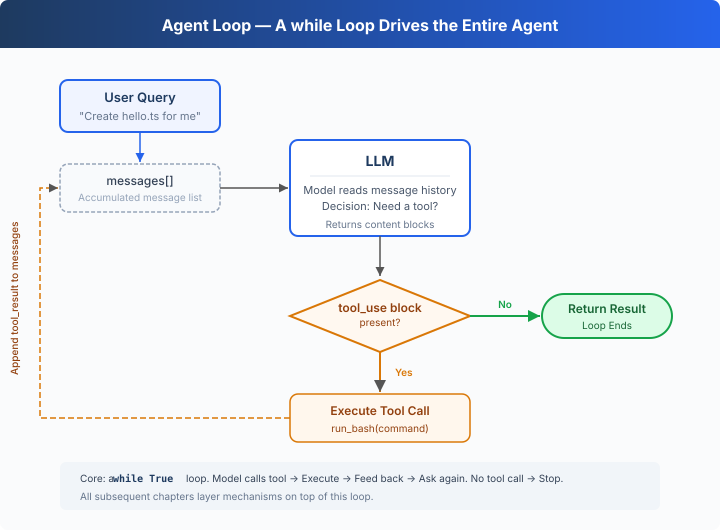

# s01: The Agent Loop — One Loop Is All You Need

[English](README.md) · [中文](README.zh.md) · [日本語](README.ja.md)

`s01` → [s02](../s02_tool_use/) → s03 → s04 → ... → s16 → s17
> *"One loop & Bash is all you need"* — One tool + one loop = one Agent.
>
> **Harness Layer**: The Loop — the first bridge between the model and the real world.

---

## The Problem

You ask the model: "List the files in my directory and run XXX.ts."

The model can output a bash command, but once it's done outputting, it stops — it won't execute the command on its own, and it won't keep reasoning based on the result.

You could run it manually, paste the output back into the chat, and let it continue. Next command comes out, you run it again, paste it back.

Every round-trip, you're the middle layer. Automating that is what this chapter is about.

---

## The Solution



A `while True` loop: keep going when the model calls a tool, stop when it doesn't. The loop checks the response content blocks directly:

| Signal | Meaning | Loop Action |
|--------|---------|-------------|
| Contains a `tool_use` block | Model requests a tool call | Execute → feed result back → continue |
| Contains no `tool_use` block | Model did not call a tool | Exit loop |

---

## How It Works

Let's translate this process into code. Step by step:

**Step 1**: Start with the user's question as the first message.

```typescript
const messages = [{"role": "user", "content": query}];
```

**Step 2**: Send the messages and tool definitions to the LLM.

```typescript
const response = await client.messages.create({
    model: MODEL, system: SYSTEM, messages: messages,
    tools: TOOLS, max_tokens: 8000,
});
```

**Step 3**: Append the model's response and check whether it called a tool. No tool call → done.

```typescript
messages.push({"role": "assistant", "content": response.content});
const tool_calls = response.content.filter(
    (block: any) => block.type === "tool_use",
);
if (tool_calls.length === 0) {
    return;
}
```

Only concrete `tool_use` blocks enter the execution stage, so the loop never appends an empty tool-result message.

**Step 4**: Execute the tool the model requested and collect the results.

```typescript
const results = [];
for (const block of tool_calls) {
    const output = run_bash(block.input["command"]);
    results.push({
        "type": "tool_result",
        "tool_use_id": block.id,
        "content": output,
    });
}
```

**Step 5**: Append the tool results as a new message and go back to Step 2.

```typescript
messages.push({"role": "user", "content": results});
```

Assembled into a complete function:

```typescript
async function agent_loop(messages: any[]): Promise<void> {
    while (true) {
        const response = await client.messages.create({
            model: MODEL, system: SYSTEM, messages: messages,
            tools: TOOLS, max_tokens: 8000,
        });
        messages.push({"role": "assistant", "content": response.content});

        const tool_calls = response.content.filter(
            (block: any) => block.type === "tool_use",
        );
        if (tool_calls.length === 0) {
            return;
        }

        const results = [];
        for (const block of tool_calls) {
            const output = run_bash(block.input["command"]);
            results.push({
                "type": "tool_result",
                "tool_use_id": block.id,
                "content": output,
            });
        }
        messages.push({"role": "user", "content": results});
    }
}
```

Just over 30 lines — that's the minimal runnable agent harness kernel. It's not intelligence itself, but the smallest runtime framework that lets the model keep acting. The model decides (whether to call a tool, which one), the harness executes (calls the tool and appends the result as a new message). The next 16 chapters all add mechanisms on top of this loop. The loop itself never changes.

---

## Try It

> **Safety notice**: The code executes shell commands generated by the model. Run it in a temporary test directory to avoid affecting your project files. s03 adds permission controls.

**Setup** (first run):

```sh
npm install
cp .env.example .env
# Edit .env, fill in ANTHROPIC_API_KEY and MODEL_ID
```

**Run**:

```sh
npx tsx s01_agent_loop/code.ts
```

Try these prompts:

1. `Create a file called hello.ts that prints "Hello, World!"`
2. `List all Python files in this directory`
3. `What is the current git branch?`

What to watch for: When does the model call a tool (loop continues), and when does it not (loop ends)?

---

## What's Next

Right now the model only has bash — reading files requires `cat`, writing files requires `echo ... >`, finding files requires `find`. Ugly and error-prone.

→ s02 Tool Use: What happens when we give it 5 proper tools? Will the model call multiple tools at once? Will parallel tool executions step on each other?


<!-- translation-sync: zh@v2, en@v2, ja@v2 -->
