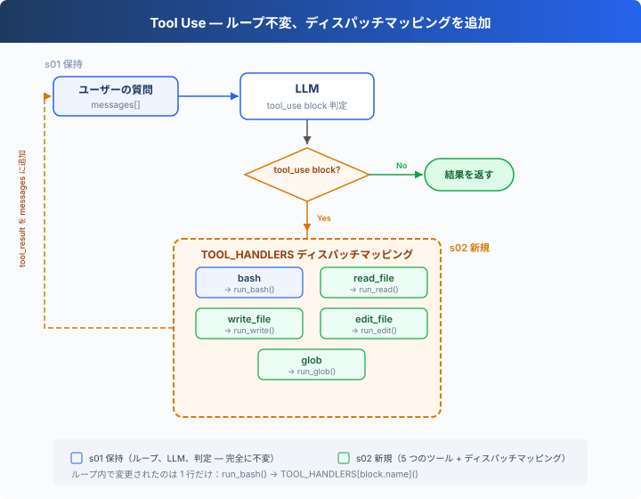

# s02: Tool Use — ツール一つ追加、一行追加だけ

[English](README.md) · [中文](README.zh.md) · [日本語](README.ja.md)

s01 → `s02` → [s03](../s03_permission/) → s04 → ... → s16 → s17
> *"ツールを一つ追加、ハンドラを一つ追加"* — ループはそのまま。新しいツールをディスパッチマップに登録するだけ。
>
> **Harness レイヤー**: ツールディスパッチ — モデルが触れる範囲を拡張。

---

## ツールは bash 一つだけ

s01 の Agent には bash 一つのツールしかない。ファイルを読むには `cat`、書くには `echo "..." > file.ts`、編集するには `sed`。

モデルは「このファイルを読みたい」と考えながら、`cat path/to/file` と組み立てなければならない。翻訳の層が一つ増え、トークンを無駄にし、エラーも起きやすい。

---

## 概要：ツールディスパッチ



s01 のループは完全に保持される（LLM 呼び出し、`tool_use` block 判定、メッセージ追加 — 一文字も変更なし）。唯一の変更点はツール実行の 1 行：`run_bash()` が `TOOL_HANDLERS[block.name]()` の検索ディスパッチに置き換わる。

Agent にツールを追加するには、たった二つ：

1. **ツールを定義**：`TOOLS` 配列に一条を追加
2. **ハンドラを登録**：`TOOL_HANDLERS` 辞書に一つのマッピングを追加

---

## 1 つのツールから 5 つのツールへ

s01 には bash だけだった：

```typescript
const TOOLS = [{"name": "bash", /* ... */}];

function run_bash(command: string): string { /* ... */ }
```

s02 では 5 つに増え、各ツールは独立して定義される：

```typescript
const TOOLS = [
    {"name": "bash",       "description": "Run a shell command.", /* ... */},
    {"name": "read_file",  "description": "Read file contents.",  /* ... */},
    {"name": "write_file", "description": "Write content to file.", /* ... */},
    {"name": "edit_file",  "description": "Replace text in file once.", /* ... */},
    {"name": "glob",       "description": "Find files by pattern.", /* ... */},
];
```

各ツールには専用の実装関数がある：

```typescript
function run_read(path: string, limit: number | null = null): string {
    let lines = readFileSync(safe_path(path), "utf-8").split("\n");
    if (lines.length && lines[lines.length - 1] === "") lines.pop();
    if (limit) {
        lines = lines.slice(0, limit);
    }
    return lines.join("\n");
}

function run_write(path: string, content: string): string {
    writeFileSync(safe_path(path), content, "utf-8");
    return `Wrote ${content.length} bytes to ${path}`;
}

function run_edit(path: string, old_text: string, new_text: string): string {
    const text = readFileSync(safe_path(path), "utf-8");
    if (!text.includes(old_text)) {
        return "Error: text not found";
    }
    writeFileSync(safe_path(path), text.replace(old_text, () => new_text), "utf-8");
    return `Edited ${path}`;
}

function run_glob(pattern: string): string {
    const matches = [...new Set(globSync(pattern, { cwd: WORKDIR }))].sort();
    const shown = matches.slice(0, 200);
    if (matches.length > 200) {
        shown.push("... (more matches omitted; narrow the pattern)");
    }
    return shown.join("\n");
}
```

---

## ツールディスパッチ

```typescript
const TOOL_HANDLERS: Record<string, (input: any) => string> = {
    "bash":       (input: any) => run_bash(input.command),
    "read_file":  (input: any) => run_read(input.path, input.limit ?? null),
    "write_file": (input: any) => run_write(input.path, input.content),
    "edit_file":  (input: any) => run_edit(input.path, input.old_text, input.new_text),
    "glob":       (input: any) => run_glob(input.pattern),
};

// ループ内で変更されたのは一行だけ — ハードコードの run_bash から検索ディスパッチへ：
for (const block of tool_calls) {
    const handler = TOOL_HANDLERS[block.name];    // 検索
    const output = handler(block.input);         // 呼び出し
    results.push(/* ... */);
}
```

ツールの追加 = `TOOLS` 配列に一条 + `TOOL_HANDLERS` 辞書に一行。ループは変わらない。

---

## 複数のツール呼び出し

モデルはよく一度に複数の tool_use を返す — 「a.ts と b.ts を読んで、全 .ts ファイルを列挙して」。

これらの呼び出しは、`response.content` に現れる元の順序で一つずつ実行する。

---

## 速查

| 概念 | 一言で |
|------|--------|
| TOOL_HANDLERS | ツール名 → ハンドラ関数の辞書。ツール追加 = マッピング一行追加 |
| ツール定義 | モデルに「何ができるか」を伝える JSON schema |
| 複数ツール呼び出し | モデルは一度に複数の tool_use を返す可能性があり、元の順序で一つずつ実行する |
| ループ不変 | s01 の `while True` ループ — 一行も変更なし |

---

## s01 からの変更

| コンポーネント | 変更前 (s01) | 変更後 (s02) |
|--------------|-------------|-------------|
| ツール数 | 1 (bash) | 5 (+read, write, edit, glob) |
| ツール実行 | ハードコード `run_bash()` | TOOL_HANDLERS 検索ディスパッチ |
| パス安全性 | なし | safe_path 検証（file tools のみ） |
| ループ | `while True` + `tool_use` block | s01 と完全に同一 |

---

## 試してみよう

```sh
cd learn-claude-code
npx tsx s02_tool_use/code.ts
```

以下のプロンプトを試してみよう：

1. `Read the file README.md and tell me what this project is about`
2. `Create a file called test.ts that prints "hello", then read it back`
3. `Find all TypeScript files in this directory`
4. `Read both README.md and package.json, then create a summary file`

観察のポイント：モデルがツールを一つだけ呼び出すときと、複数同時に呼び出すときの違い。複数のツール呼び出しは正しい順序で実行されているか？

---

## 次へ

Agent は 5 つの専用ツールを持つようになった。file tools は `safe_path` で保護されるが、bash は制限なし — `rm -rf /` はまだ実行できる。

→ s03 Permission：ツール実行前にゲートを追加 — この操作は安全か？ ユーザーの承認が必要か？


<!-- translation-sync: zh@v1, en@v1, ja@v1 -->
