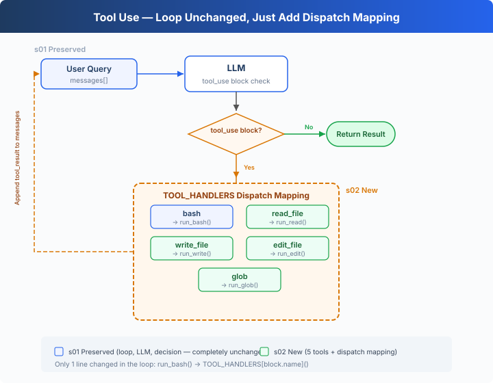

# s02: Tool Use — Add a Tool, Add Just One Line

[English](README.md) · [中文](README.zh.md) · [日本語](README.ja.md)

s01 → `s02` → [s03](../s03_permission/) → s04 → ... → s16 → s17
> *"Add a tool, add just one handler"* — The loop stays the same. Register the new tool in the dispatch map and you're done.
>
> **Harness Layer**: Tool Dispatch — Expanding the model's reach.

---

## Only One Tool: Bash

The s01 Agent has only one tool: bash. To read a file, `cat`; to write, `echo "..." > file.ts`; to edit, `sed`.

The model thinks "read this file" but has to spell out `cat path/to/file`. An extra layer of translation that wastes tokens and invites errors.

---

## Overview: Tool Dispatch



The s01 loop is fully preserved (LLM call, `tool_use` block check, message append — not a single word changed). The only change is in that one line of tool execution: `run_bash()` is replaced with `TOOL_HANDLERS[block.name]()` dispatch lookup.

Adding a tool to the Agent requires just two things:

1. **Define the tool**: Add one entry to the `TOOLS` array
2. **Register the handler**: Add one mapping in the `TOOL_HANDLERS` dict

---

## From 1 Tool to 5 Tools

s01 had only bash:

```typescript
const TOOLS = [{"name": "bash", /* ... */}];

function run_bash(command: string): string { /* ... */ }
```

s02 expands to 5 tools, each independently defined:

```typescript
const TOOLS = [
    {"name": "bash",       "description": "Run a shell command.", /* ... */},
    {"name": "read_file",  "description": "Read file contents.",  /* ... */},
    {"name": "write_file", "description": "Write content to file.", /* ... */},
    {"name": "edit_file",  "description": "Replace text in file once.", /* ... */},
    {"name": "glob",       "description": "Find files by pattern.", /* ... */},
];
```

Each tool has its own implementation function:

```typescript
function run_read(path: string, limit: number | null = null): string {
    let lines = readFileSync(safe_path(path), "utf-8").split("\n");
    if (lines.length && lines[lines.length - 1] === "") lines.pop();
    if (limit) {
        lines = lines.slice(0, limit);
    }
    return lines.join("\n");
}

function run_write(path: string, content: string): string {
    writeFileSync(safe_path(path), content, "utf-8");
    return `Wrote ${content.length} bytes to ${path}`;
}

function run_edit(path: string, old_text: string, new_text: string): string {
    const text = readFileSync(safe_path(path), "utf-8");
    if (!text.includes(old_text)) {
        return "Error: text not found";
    }
    writeFileSync(safe_path(path), text.replace(old_text, () => new_text), "utf-8");
    return `Edited ${path}`;
}

function run_glob(pattern: string): string {
    const matches = [...new Set(globSync(pattern, { cwd: WORKDIR }))].sort();
    const shown = matches.slice(0, 200);
    if (matches.length > 200) {
        shown.push("... (more matches omitted; narrow the pattern)");
    }
    return shown.join("\n");
}
```

---

## Tool Dispatch

```typescript
const TOOL_HANDLERS: Record<string, (input: any) => string> = {
    "bash":       (input: any) => run_bash(input.command),
    "read_file":  (input: any) => run_read(input.path, input.limit ?? null),
    "write_file": (input: any) => run_write(input.path, input.content),
    "edit_file":  (input: any) => run_edit(input.path, input.old_text, input.new_text),
    "glob":       (input: any) => run_glob(input.pattern),
};

// Only one line changed in the loop — from hardcoded run_bash to dispatch lookup:
for (const block of tool_calls) {
    const handler = TOOL_HANDLERS[block.name];    // lookup
    const output = handler(block.input);         // call
    results.push(/* ... */);
}
```

Adding a tool = one entry in `TOOLS` array + one line in `TOOL_HANDLERS` dict. The loop stays the same.

---

## Multiple Tool Calls

The model often returns multiple tool_use calls at once — "read a.ts and b.ts, then list all .ts files".

Calls are executed one by one in their original `response.content` order.

---

## Quick Reference

| Concept | One-Liner |
|---------|-----------|
| TOOL_HANDLERS | Tool name → handler function dict. Add a tool = add one mapping line |
| Tool Definition | JSON schema telling the model "what I can do" |
| Multiple tool calls | Model may return multiple tool_use at once; calls execute in their original order |
| Loop Unchanged | s01's `while True` loop — not a single line changed |

---

## Changes from s01

| Component | Before (s01) | After (s02) |
|-----------|-------------|-------------|
| Tool count | 1 (bash) | 5 (+read, write, edit, glob) |
| Tool execution | Hardcoded `run_bash()` | TOOL_HANDLERS dispatch lookup |
| Path safety | None | safe_path validation (file tools only) |
| Loop | `while True` + `tool_use` block | Identical to s01 |

---

## Try It

```sh
cd learn-claude-code
npx tsx s02_tool_use/code.ts
```

Try these prompts:

1. `Read the file README.md and tell me what this project is about`
2. `Create a file called test.ts that prints "hello", then read it back`
3. `Find all TypeScript files in this directory`
4. `Read both README.md and package.json, then create a summary file`

What to watch for: When does the model call just one tool, and when does it call multiple at once? Are multiple tool calls executed in the correct order?

---

## What's Next

The Agent now has 5 specialized tools. File tools are protected by `safe_path`, but bash is unrestricted — `rm -rf /` still runs.

→ s03 Permission: Add a gate before tool execution — is this operation safe? Does it need user approval?


<!-- translation-sync: zh@v1, en@v1, ja@v1 -->
