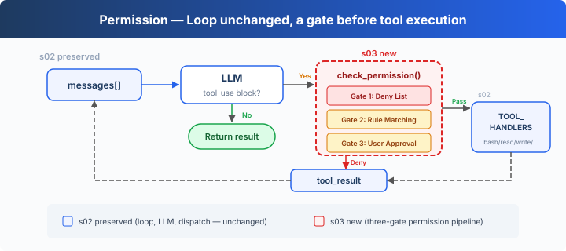
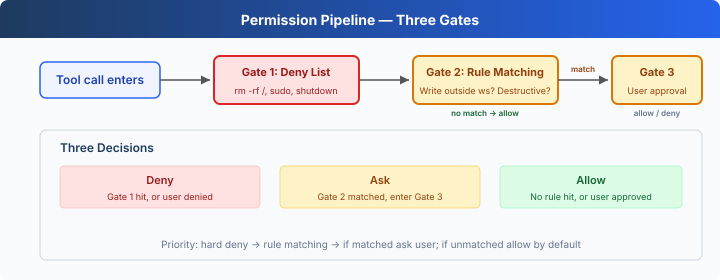

# s03: Permission — Check Permissions Before Execution

[English](README.md) · [中文](README.zh.md) · [日本語](README.ja.md)

s01 → s02 → `s03` → [s04](../s04_hooks/) → s05 → ... → s16 → s17
> *"Check permissions before executing"* — The permission pipeline decides which operations need approval.
>
> **Harness Layer**: Permission — a gate before tool execution.

---

## The Problem

s02's Agent has 5 tools. File tools are protected by `safe_path`, but bash is unrestricted. Ask it to "clean up the project," and it might run `rm -rf /`.

Safety can't rely on trusting the model — it needs code: a check before every tool execution.

---

## The Solution



s02's loop is fully preserved. The only change is inserting `check_permission()` before tool execution — each tool call passes through three gates in a fixed order: hard deny first, then soft ask, and if neither matches, allow.

The three gates correspond to three decisions:

| Gate | Purpose | On Match |
|------|---------|----------|
| 1. Deny List | Permanently forbidden operations (`rm -rf /`, `sudo`) | Denied immediately, not executed |
| 2. Rule Matching | Context-dependent operations (reading/writing outside workspace, `rm` files) | Passed to Gate 3 |
| 3. User Approval | After Gate 2 matches, pauses for user confirmation | User decides allow or deny |

None of the three gates match → execute directly. Most routine operations take this path.

---

## How It Works



**Gate 1**: A hard deny list. Check first; if matched, return a block message. This list uses simple string matching to show where the permission gate sits; it is not a complete security boundary.

```typescript
const DENY_LIST = [
    "rm -rf /", "sudo", "shutdown", "reboot",
    "mkfs", "dd if=", "> /dev/sda",
];

function check_deny_list(command: string): string | null {
    for (const pattern of DENY_LIST) {
        if (command.includes(pattern)) {
            return `Blocked: '${pattern}' is on the deny list`;
        }
    }
    return null;
}
```

**Gate 2**: Rule matching — describes "when to ask the user." Each rule specifies a tool and a check condition.

```typescript
import { isAbsolute, relative, resolve } from "node:path";

const DESTRUCTIVE_COMMAND_WORD = /(?:^|[;&|()\n])\s*(?:rm|del)(?=\s|$|[;&|()])/i;

function contains_destructive_command(command: string): boolean {
    return Boolean(DESTRUCTIVE_COMMAND_WORD.test(command));
}

const PERMISSION_RULES = [
    {
        "tools": ["read_file", "write_file", "edit_file"],
        "check": (args: any) => {
            const rel = relative(WORKDIR, resolve(WORKDIR, args.path ?? ""));
            return rel.startsWith("..") || isAbsolute(rel);
        },
        "message": "Access outside workspace",
    },
    {
        "tools": ["bash"],
        "check": (args: any) => contains_destructive_command(args.command ?? "") || ["rm ", "> /etc/", "chmod 777"].some(
            (kw) => (args.command ?? "").includes(kw),
        ),
        "message": "Potentially destructive command",
    },
];

function check_rules(tool_name: string, args: any): string | null {
    for (const rule of PERMISSION_RULES) {
        if (rule["tools"].includes(tool_name) && rule["check"](args)) {
            return rule["message"];
        }
    }
    return null;
}
```

**Gate 3**: After a rule matches, pause for user input.

```typescript
async function ask_user(tool_name: string, args: any, reason: string): Promise<string> {
    console.log(`\n⚠  ${reason}`);
    console.log(`   Tool: ${tool_name}(${args})`);
    const choice = (await input("   Allow? [y/N] ")).trim().toLowerCase();
    return ["y", "yes"].includes(choice) ? "allow" : "deny";
}
```

**All three gates chained together**, inserted before tool execution:

```typescript
async function check_permission(block: any): Promise<boolean> {
    // Gate 1: Hard deny
    if (block.name === "bash") {
        const reason = check_deny_list(block.input.command ?? "");
        if (reason) {
            console.log(`\n⛔ ${reason}`);
            return false;
        }
    }

    // Gate 2 + 3: Rule matching → User approval
    const reason = check_rules(block.name, block.input);
    if (reason) {
        const decision = await ask_user(block.name, block.input, reason);
        if (decision === "deny") {
            return false;
        }
    }

    return true;
}

// In agent_loop — s02's loop with just one line added:
for (const block of tool_calls) {
    if (!(await check_permission(block))) {           // ← NEW
        results.push({/* ... */ "content": "Permission denied."});
        continue;
    }
    const output = TOOL_HANDLERS[block.name](block.input);  // s02 original
    results.push(/* ... */);
}
```

---

## Changes from s02

| Component | Before (s02) | After (s03) |
|-----------|-------------|-------------|
| Security model | None (trust the model) | Three-gate permission pipeline |
| New functions | — | check_deny_list, check_rules, ask_user, check_permission |
| Loop | Executes all tools directly | Inserts check_permission() before execution |

---

## Try It

```sh
cd learn-claude-code
npx tsx s03_permission/code.ts
```

Try these prompts:

1. `Create a file called test.txt in the current directory` (should pass through)
2. `Delete the file test.txt` (bash + rm triggers Gate 2)
3. `What files are in the current directory?` (read-only, all pass)
4. `Try to write a file to /etc/something` (writing outside workspace triggers Gate 2)
5. On Windows, `del test.txt` and `DEL test.txt` trigger Gate 2, while `model`, `delimiter`, and `echo del test.txt` do not.

What to watch for: Which operations pass through? Which need your confirmation? Which are denied outright?

---

## What's Next

Permission checks are in place — but every check is hardcoded as `check_permission()` inside the loop. What if you want to add logging before and after each tool execution? What if you want to auto-trigger a git commit after certain operations? Scattering this extension logic throughout the loop makes it bloat.

→ s04 Hooks: Add hooks to the loop. Extension logic hangs on hooks; the loop stays clean.


<!-- translation-sync: zh@v1, en@v1, ja@v1 -->
