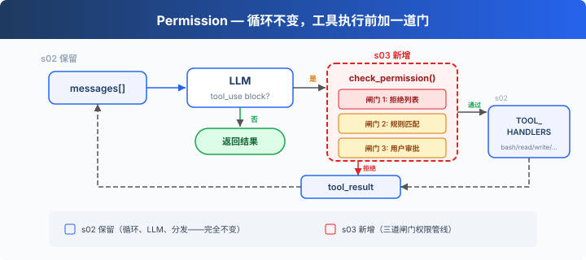
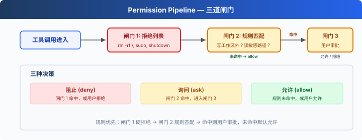

# s03: Permission — 执行前做权限判断

[English](README.md) · [中文](README.zh.md) · [日本語](README.ja.md)

s01 → s02 → `s03` → [s04](../s04_hooks/) → s05 → ... → s16 → s17
> *"工具执行前先做权限判断"* — 权限管线决定哪些操作需要审批。
>
> **Harness 层**: 权限 — 在工具执行前加一道门。

---

## 问题

s02 的 Agent 有 5 个工具。file tools 受 `safe_path` 保护，但 bash 不受限制。让它"清理一下项目"，可能执行 `rm -rf /`。

安全边界由代码负责，判断发生在工具执行之前。

---

## 解决方案



s02 的循环完全保留。唯一的变动是在工具执行前插入 `check_permission()`。每个工具调用依次经过三道闸门：硬拒绝优先，软询问次之，都没命中就放行。

三道闸门对应三种决策：

| 闸门 | 作用 | 命中后 |
|------|------|--------|
| 1. 拒绝列表 | 永远禁止的操作（`rm -rf /`、`sudo`） | 直接拒绝，不执行 |
| 2. 规则匹配 | 取决于上下文的操作（读/写工作区外、`rm` 文件） | 交给闸门 3 |
| 3. 用户审批 | 闸门 2 命中后，暂停等用户确认 | 用户决定允许或拒绝 |

三道都没命中 → 直接执行。大部分日常操作走这条路。

---

## 工作原理



**闸门 1**：一张硬拒绝表，先查，命中就返回阻止信息。这张表使用简单字符串匹配来说明权限闸门的位置，不能视为完整的安全边界。

```typescript
const DENY_LIST = [
    "rm -rf /", "sudo", "shutdown", "reboot",
    "mkfs", "dd if=", "> /dev/sda",
];

function check_deny_list(command: string): string | null {
    for (const pattern of DENY_LIST) {
        if (command.includes(pattern)) {
            return `Blocked: '${pattern}' is on the deny list`;
        }
    }
    return null;
}
```

**闸门 2**负责规则匹配，用来描述"什么时候需要问用户"。每条规则指定工具和检查条件。

```typescript
import { isAbsolute, relative, resolve } from "node:path";

const DESTRUCTIVE_COMMAND_WORD = /(?:^|[;&|()\n])\s*(?:rm|del)(?=\s|$|[;&|()])/i;

function contains_destructive_command(command: string): boolean {
    return Boolean(DESTRUCTIVE_COMMAND_WORD.test(command));
}

const PERMISSION_RULES = [
    {
        "tools": ["read_file", "write_file", "edit_file"],
        "check": (args: any) => {
            const rel = relative(WORKDIR, resolve(WORKDIR, args.path ?? ""));
            return rel.startsWith("..") || isAbsolute(rel);
        },
        "message": "Access outside workspace",
    },
    {
        "tools": ["bash"],
        "check": (args: any) => contains_destructive_command(args.command ?? "") || ["rm ", "> /etc/", "chmod 777"].some(
            (kw) => (args.command ?? "").includes(kw),
        ),
        "message": "Potentially destructive command",
    },
];

function check_rules(tool_name: string, args: any): string | null {
    for (const rule of PERMISSION_RULES) {
        if (rule["tools"].includes(tool_name) && rule["check"](args)) {
            return rule["message"];
        }
    }
    return null;
}
```

**闸门 3**：规则命中后，暂停等用户输入。

```typescript
async function ask_user(tool_name: string, args: any, reason: string): Promise<string> {
    console.log(`\n⚠  ${reason}`);
    console.log(`   Tool: ${tool_name}(${args})`);
    const choice = (await input("   Allow? [y/N] ")).trim().toLowerCase();
    return ["y", "yes"].includes(choice) ? "allow" : "deny";
}
```

**三道闸门串在一起**，插在工具执行之前：

```typescript
async function check_permission(block: any): Promise<boolean> {
    // 闸门 1: 硬拒绝
    if (block.name === "bash") {
        const reason = check_deny_list(block.input.command ?? "");
        if (reason) {
            console.log(`\n⛔ ${reason}`);
            return false;
        }
    }

    // 闸门 2 + 3: 规则匹配 → 用户审批
    const reason = check_rules(block.name, block.input);
    if (reason) {
        const decision = await ask_user(block.name, block.input, reason);
        if (decision === "deny") {
            return false;
        }
    }

    return true;
}

// 在 agent_loop 中——s02 的循环只加了一行：
for (const block of tool_calls) {
    if (!(await check_permission(block))) {           // ← 新增
        results.push({/* ... */ "content": "Permission denied."});
        continue;
    }
    const output = TOOL_HANDLERS[block.name](block.input);  // s02 原有
    results.push(/* ... */);
}
```

---

## 相对 s02 的变更

| 组件 | 之前 (s02) | 之后 (s03) |
|------|-----------|-----------|
| 安全模型 | 无（信任模型） | 三道闸门权限管线 |
| 新函数 | — | check_deny_list, check_rules, ask_user, check_permission |
| 循环 | 直接执行所有工具 | 执行前插入 check_permission() |

---

## 试一下

```sh
cd learn-claude-code
npx tsx s03_permission/code.ts
```

试试这些 prompt：

1. `Create a file called test.txt in the current directory`（应该直接通过）
2. `Delete the file test.txt`（bash + rm 会触发闸门 2）
3. `What files are in the current directory?`（只读，全部通过）
4. `Try to write a file to /etc/something`（写工作区外，触发闸门 2）
5. 在 Windows 上，`del test.txt` 和 `DEL test.txt` 会触发闸门 2，而 `model`、`delimiter` 和 `echo del test.txt` 不会。

观察重点：哪些操作直接通过？哪些需要你确认？哪些被直接拒绝？

---

## 接下来

当前权限检查每次都在循环里硬编码 `check_permission()`。如果我想在每次工具执行前后加日志？如果想在某些操作后自动触发 git commit？这些扩展逻辑散落在 loop 里，循环很快就会膨胀。

s04 Hooks → 给循环加钩子，扩展逻辑挂在钩子上，循环保持干净。


<!-- translation-sync: zh@v1, en@v1, ja@v1 -->
