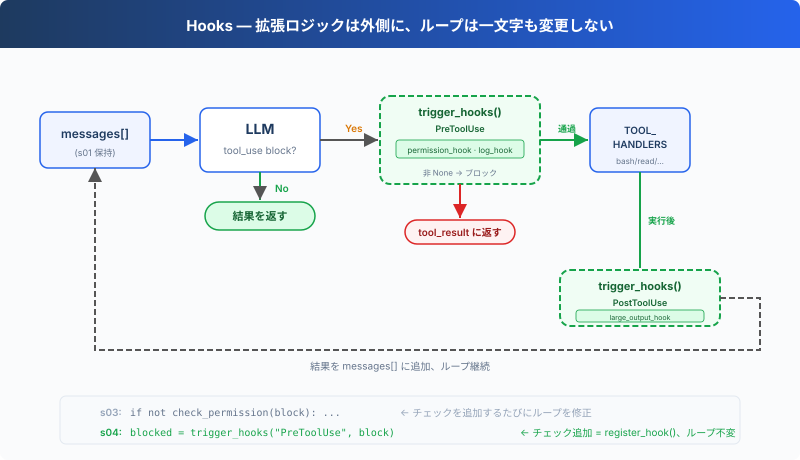

# s04: Hooks — ループに掛ける、ループには書き込まない

[English](README.md) · [中文](README.zh.md) · [日本語](README.ja.md)

s01 → s02 → s03 → `s04` → [s05](../s05_todo_write/) → s06 → ... → s16 → s17

> *"ループに掛ける、ループには書き込まない"* — フックがツール実行の前後に拡張ロジックを注入する。
>
> **Harness レイヤー**: フック — ループを侵襲しない拡張ポイント。

---

## 課題

s03 の Agent には権限チェックがある。しかし新しいチェックを追加するたび、「bash 呼び出しを毎回ログに記録」「操作後に自動 git add」、`agent_loop` 関数を修正する必要がある。

ループはすぐにこうなる：

```typescript
function agent_loop(messages: any[]): void {
    while (true) {
        // ... LLM call ...
        for (const block of response.content) {
            if (block.type !== "tool_use") {
                continue;
            }
            log_to_file(block);          // 一行追加
            check_permission(block);     // 一行追加
            notify_slack(block);         // さらに一行追加
            const output = execute(block);
            auto_git_add(block);         // さらに一行追加
            // ... もうループが見えない
        }
    }
}
```

拡張したいのは Agent の振る舞いなのに、変更しているのはループそのもの。ループは安定した核心であるべき。拡張は外側に掛ける。

---

## ソリューション



s03 のループと権限ロジックは完全に保持される。唯一の変更点は `check_permission()` をループ本体内からフックに移動したこと。ループはもうチェック関数を直接呼び出さず、代わりに `trigger_hooks("PreToolUse", block)` を呼び、登録済みのフックが何を実行するかを決める。

4 つのイベントで、完全な agent cycle をカバー：

| イベント | 発火タイミング | 典型的な用途 |
|----------|--------------|-------------|
| UserPromptSubmit | ユーザー入力後、LLM に入る前 | 入力バリデーション、コンテキスト注入 |
| PreToolUse | ツール実行前 | 権限チェック、ログ記録 |
| PostToolUse | ツール実行後 | 副作用（自動 git add など）、出力チェック |
| Stop | ループが終了する直前 | 後処理、ループを続行するかの判断 |

拡張は `register_hook()` で追加する。ループは `trigger_hooks()` を呼ぶだけ。

---

## 仕組み

**フック登録簿**：イベント名をコールバックリストにマッピングする辞書。

```typescript
const HOOKS: Record<string, Array<(...args: any[]) => any>> = {
    "UserPromptSubmit": [],
    "PreToolUse": [],
    "PostToolUse": [],
    "Stop": [],
};

function register_hook(event: string, callback: (...args: any[]) => any): void {
    HOOKS[event].push(callback);
}

async function trigger_hooks(event: string, ...args: any[]): Promise<any> {
    for (const callback of HOOKS[event]) {
        const result = await callback(...args);
        if (result != null) {   // 戻り値 ≠ null → フックが「止め」と指示
            return result;
        }
    }
    return null;
}
```

`PreToolUse` が `None` 以外を返すと、現在のツール実行は中止される。`Stop` が `None` 以外を返すと、ループは続行する。`UserPromptSubmit` と `PostToolUse` の戻り値は制御フローに影響しない。

**UserPromptSubmit** はユーザー入力後、LLM に入る前に発火する。以下の hook は現在の作業ディレクトリを記録する：

```typescript
function context_inject_hook(query: string): string | null {
    // Inject current working directory info into every prompt.
    console.log(`\x1b[90m[HOOK] UserPromptSubmit: working in ${WORKDIR}\x1b[0m`);
    return null;   // return null = 変更なし、プロンプトを通す
}

register_hook("UserPromptSubmit", context_inject_hook);
```

メインループでは、ユーザー入力直後に発火：

```typescript
const query = await input("s04 >> ");
await trigger_hooks("UserPromptSubmit", query);   // ← LLM に入る前
history.push({"role": "user", "content": query});
await agent_loop(history);
```

**PreToolUse / PostToolUse**、ツール実行の前後のフック。s03 の権限チェックロジックは PreToolUse フックに包まれ、さらにログフックと大出力リマインダーが追加される：

```typescript
import { isAbsolute, relative, resolve } from "node:path";

// PreToolUse: 権限チェック（s03 のロジック、ループからフックに移動）
async function permission_hook(block: any): Promise<string | null> {
    if (block.name === "bash") {
        for (const pattern of DENY_LIST) {
            if ((block.input.command ?? "").includes(pattern)) {
                return "Permission denied by deny list";
            }
        }
    }
    if (["read_file", "write_file", "edit_file"].includes(block.name)) {
        const path = block.input.path ?? "";
        const rel = relative(WORKDIR, resolve(WORKDIR, path));
        if (rel.startsWith("..") || isAbsolute(rel)) {
            const choice = (await input("   Allow? [y/N] ")).trim().toLowerCase();
            if (!["y", "yes"].includes(choice)) {
                return "Permission denied by user";
            }
        }
    }
    return null;
}

// PreToolUse: ログ
function log_hook(block: any): void {
    console.log(`[HOOK] ${block.name}(...)`);
}

// PostToolUse: 大ファイルリマインダー
function large_output_hook(block: any, output: any): void {
    if (String(output).length > 100000) {
        console.log(`[HOOK] ⚠ Large output from ${block.name}`);
    }
}

register_hook("PreToolUse", permission_hook);
register_hook("PreToolUse", log_hook);
register_hook("PostToolUse", large_output_hook);
```

**Stop** はループが終了する直前に発火する。以下の hook は終了時の統計を出力する：

```typescript
function summary_hook(messages: any[]): string | null {
    // Print a summary when the loop is about to stop.
    let tool_count = 0;
    for (const m of messages) {
        const content = Array.isArray(m["content"]) ? m["content"] : [];
        for (const b of content) {
            if (b !== null && typeof b === "object" && b["type"] === "tool_result") {
                tool_count += 1;
            }
        }
    }
    console.log(`\x1b[90m[HOOK] Stop: session used ${tool_count} tool calls\x1b[0m`);
    return null;   // return null = 終了を許可、return 文字列 = 強制続行
}

register_hook("Stop", summary_hook);
```

agent_loop 内では、終了前に発火：

```typescript
const tool_calls = response.content.filter(
    (block: any) => block.type === "tool_use",
);
if (tool_calls.length === 0) {
    const force = await trigger_hooks("Stop", messages);   // ← 終了する前に
    if (force) {
        // フックがメッセージを返した → 注入して続行
        messages.push({"role": "user", "content": force});
        continue;
    }
    return;
}
```

**ループ内で変更されたのは一箇所だけ**：s03 は直接 `check_permission(block)` を呼び出していたが、s04 は `trigger_hooks("PreToolUse", block)` に置き換えた：

```typescript
for (const block of tool_calls) {
    // s03: if (!(await check_permission(block))) { ... }
    // s04: フックがハードコードを代替
    const blocked = await trigger_hooks("PreToolUse", block);
    if (blocked) {
        results.push({"type": "tool_result", "tool_use_id": block.id,
                        "content": String(blocked)});
        continue;
    }

    const handler = TOOL_HANDLERS[block.name];
    const output = handler ? handler(block.input) : `Unknown: ${block.name}`;

    await trigger_hooks("PostToolUse", block, output);

    results.push({"type": "tool_result", "tool_use_id": block.id,
                    "content": output});
}
```

4 つのフックが agent cycle の重要ノードをカバー：入力→実行前→実行後→終了。ループは trigger_hooks() を呼ぶだけで、具体的なロジックは全てフックコールバックにある。

---

## s03 からの変更

| コンポーネント | 変更前 (s03) | 変更後 (s04) |
|--------------|-------------|-------------|
| 拡張方式 | check_permission() をループ内にハードコード | HOOKS 登録簿 + trigger_hooks() |
| 新規関数 | — | register_hook, trigger_hooks |
| フックコールバック | — | context_inject_hook, permission_hook, log_hook, large_output_hook, summary_hook |
| ループ | check_permission() を直接呼び出し | trigger_hooks("PreToolUse", ...) を呼び出し |
| 終了制御 | なし | trigger_hooks("Stop", ...) が終了を阻止可能 |
| 入力横取り | なし | trigger_hooks("UserPromptSubmit", ...) がコンテキスト注入可能 |

---

## 試してみよう

```sh
cd learn-claude-code
npx tsx s04_hooks/code.ts
```

以下のプロンプトを試してみよう：

1. `Read the file README.md`（そのまま通過するはず、フックログを観察）
2. `Create a file called test.txt`（作成後、PostToolUse が発火するか観察）
3. `Delete all temporary files in /tmp`（bash + rm で権限フックが発動）

観察のポイント：各ツール実行前に `[HOOK]` ログが表示されるか？ 権限が拒否されたとき、フックが拦截したのか、ループ内のハードコードが拦截したのか？

---

## 次へ

Agent は安全に操作を実行できるようになった。しかし「まず何をして、次に何をすべきか」を立ち止まって考えたことはあるか？ 複雑なタスクを与えたとき、すぐに取り掛かるのか、まず計画を立てるのか？

→ s05 TodoWrite：Agent に計画ツールを与える。まずリストを作り、それから実行。


<!-- translation-sync: zh@v1, en@v1, ja@v1 -->
