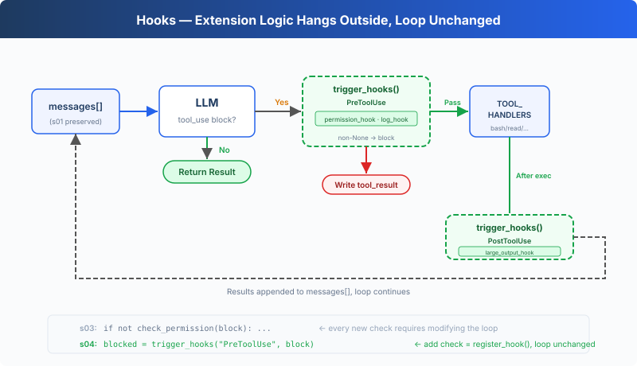

# s04: Hooks — Hang on the Loop, Don't Write into It

[English](README.md) · [中文](README.zh.md) · [日本語](README.ja.md)

s01 → s02 → s03 → `s04` → [s05](../s05_todo_write/) → s06 → ... → s16 → s17

> *"Hang on the loop, don't write into it"* — Hooks inject extension logic before and after tool execution.
>
> **Harness Layer**: Hooks — Extension points that don't invade the loop.

---

## The Problem

The s03 Agent has permission checks. But every new check, "log every bash call", "auto git add after writes", requires modifying the `agent_loop` function.

The loop quickly becomes this:

```typescript
function agent_loop(messages: any[]): void {
    while (true) {
        // ... LLM call ...
        for (const block of response.content) {
            if (block.type !== "tool_use") {
                continue;
            }
            log_to_file(block);          // added a line
            check_permission(block);     // added a line
            notify_slack(block);         // added another line
            const output = execute(block);
            auto_git_add(block);         // yet another line
            // ... the loop is unrecognizable
        }
    }
}
```

What you want to extend is the Agent's behavior, but what you're modifying is the loop itself. The loop should be a stable core; extensions should hang on the outside.

---

## The Solution



The s03 loop and permission logic are fully preserved. The only change is moving `check_permission()` from inside the loop body onto a hook. The loop no longer directly calls any check function. Instead it calls `trigger_hooks("PreToolUse", block)`, and the registry decides what to run.

Four events, covering a complete agent cycle:

| Event | Trigger Timing | Typical Use |
|-------|---------------|-------------|
| UserPromptSubmit | After user input, before entering LLM | Input validation, context injection |
| PreToolUse | Before tool execution | Permission checks, logging |
| PostToolUse | After tool execution | Side effects (auto git add etc.), output checking |
| Stop | When the loop is about to exit | Cleanup, decide whether the loop continues |

Extensions are added via `register_hook()`. The loop only calls `trigger_hooks()`.

---

## How It Works

**Hook registry**: a dict mapping event names to callback lists.

```typescript
const HOOKS: Record<string, Array<(...args: any[]) => any>> = {
    "UserPromptSubmit": [],
    "PreToolUse": [],
    "PostToolUse": [],
    "Stop": [],
};

function register_hook(event: string, callback: (...args: any[]) => any): void {
    HOOKS[event].push(callback);
}

async function trigger_hooks(event: string, ...args: any[]): Promise<any> {
    for (const callback of HOOKS[event]) {
        const result = await callback(...args);
        if (result != null) {   // return value ≠ null → hook says "stop"
            return result;
        }
    }
    return null;
}
```

When `PreToolUse` returns non-None, the current tool execution is blocked. When `Stop` returns non-None, the loop continues. Return values from `UserPromptSubmit` and `PostToolUse` do not affect control flow.

**UserPromptSubmit** triggers after user input and before entering the LLM. The following hook records the current working directory:

```typescript
function context_inject_hook(query: string): string | null {
    // Inject current working directory info into every prompt.
    console.log(`\x1b[90m[HOOK] UserPromptSubmit: working in ${WORKDIR}\x1b[0m`);
    return null;   // return null = no modification, let prompt through
}

register_hook("UserPromptSubmit", context_inject_hook);
```

In the main loop, triggered right after user input:

```typescript
const query = await input("s04 >> ");
await trigger_hooks("UserPromptSubmit", query);   // ← before entering LLM
history.push({"role": "user", "content": query});
await agent_loop(history);
```

**PreToolUse / PostToolUse**, hooks before and after tool execution. s03's permission check logic is now wrapped as a PreToolUse hook, plus a logging hook and a large-output reminder:

```typescript
import { isAbsolute, relative, resolve } from "node:path";

// PreToolUse: permission check (s03 logic, moved from loop to hook)
async function permission_hook(block: any): Promise<string | null> {
    if (block.name === "bash") {
        for (const pattern of DENY_LIST) {
            if ((block.input.command ?? "").includes(pattern)) {
                return "Permission denied by deny list";
            }
        }
    }
    if (["read_file", "write_file", "edit_file"].includes(block.name)) {
        const path = block.input.path ?? "";
        const rel = relative(WORKDIR, resolve(WORKDIR, path));
        if (rel.startsWith("..") || isAbsolute(rel)) {
            const choice = (await input("   Allow? [y/N] ")).trim().toLowerCase();
            if (!["y", "yes"].includes(choice)) {
                return "Permission denied by user";
            }
        }
    }
    return null;
}

// PreToolUse: logging
function log_hook(block: any): void {
    console.log(`[HOOK] ${block.name}(...)`);
}

// PostToolUse: large output reminder
function large_output_hook(block: any, output: any): void {
    if (String(output).length > 100000) {
        console.log(`[HOOK] ⚠ Large output from ${block.name}`);
    }
}

register_hook("PreToolUse", permission_hook);
register_hook("PreToolUse", log_hook);
register_hook("PostToolUse", large_output_hook);
```

**Stop** triggers when the loop is about to exit. The following hook prints a cleanup summary:

```typescript
function summary_hook(messages: any[]): string | null {
    // Print a summary when the loop is about to stop.
    let tool_count = 0;
    for (const m of messages) {
        const content = Array.isArray(m["content"]) ? m["content"] : [];
        for (const b of content) {
            if (b !== null && typeof b === "object" && b["type"] === "tool_result") {
                tool_count += 1;
            }
        }
    }
    console.log(`\x1b[90m[HOOK] Stop: session used ${tool_count} tool calls\x1b[0m`);
    return null;   // return null = allow stop, return string = force continuation
}

register_hook("Stop", summary_hook);
```

In agent_loop, triggered before exit:

```typescript
const tool_calls = response.content.filter(
    (block: any) => block.type === "tool_use",
);
if (tool_calls.length === 0) {
    const force = await trigger_hooks("Stop", messages);   // ← before exiting
    if (force) {
        // hook returned a message → inject it and continue
        messages.push({"role": "user", "content": force});
        continue;
    }
    return;
}
```

**Only one change in the loop**: s03 directly called `check_permission(block)`, s04 replaces it with `trigger_hooks("PreToolUse", block)`:

```typescript
for (const block of tool_calls) {
    // s03: if (!(await check_permission(block))) { ... }
    // s04: hooks replace hardcoding
    const blocked = await trigger_hooks("PreToolUse", block);
    if (blocked) {
        results.push({"type": "tool_result", "tool_use_id": block.id,
                        "content": String(blocked)});
        continue;
    }

    const handler = TOOL_HANDLERS[block.name];
    const output = handler ? handler(block.input) : `Unknown: ${block.name}`;

    await trigger_hooks("PostToolUse", block, output);

    results.push({"type": "tool_result", "tool_use_id": block.id,
                    "content": output});
}
```

Four hooks cover the critical nodes of the agent cycle: input → before execution → after execution → exit. The loop only calls trigger_hooks(); all logic lives in hook callbacks.

---

## Changes from s03

| Component | Before (s03) | After (s04) |
|-----------|-------------|-------------|
| Extension method | check_permission() hardcoded in the loop | HOOKS registry + trigger_hooks() |
| New functions | — | register_hook, trigger_hooks |
| Hook callbacks | — | context_inject_hook, permission_hook, log_hook, large_output_hook, summary_hook |
| Loop | Directly calls check_permission() | Calls trigger_hooks("PreToolUse", ...) |
| Exit control | None | trigger_hooks("Stop", ...) can prevent exit |
| Input interception | None | trigger_hooks("UserPromptSubmit", ...) can inject context |

---

## Try It

```sh
cd learn-claude-code
npx tsx s04_hooks/code.ts
```

Try these prompts:

1. `Read the file README.md` (should pass directly, observe hook logs)
2. `Create a file called test.txt` (after creation, observe if PostToolUse fires)
3. `Delete all temporary files in /tmp` (bash + rm triggers permission hook)

What to watch for: Before each tool execution, does the `[HOOK]` log appear? When permission is denied, was it intercepted by a hook or hardcoded in the loop?

---

## What's Next

The Agent can now safely execute operations. But does it ever stop to think "what should I do first, and what next?" Given a complex task, does it jump straight in, or plan first?

→ s05 TodoWrite: Give the Agent a planning tool. Make a list first, then execute.


<!-- translation-sync: zh@v1, en@v1, ja@v1 -->
