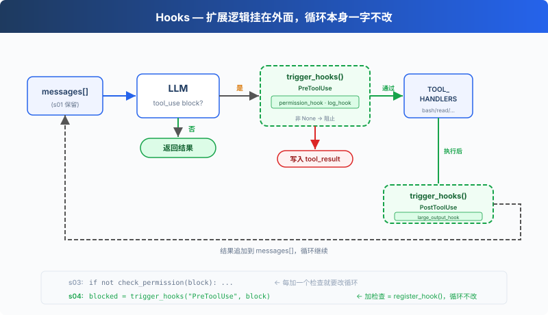

# s04: Hooks — 挂在循环上，不写进循环里

[English](README.md) · [中文](README.zh.md) · [日本語](README.ja.md)

s01 → s02 → s03 → `s04` → [s05](../s05_todo_write/) → s06 → ... → s16 → s17

> *"挂在循环上, 不写进循环里"* — hook 在工具执行前后注入扩展逻辑。
>
> **Harness 层**: hook — 扩展点不侵入循环。

---

## 问题

s03 的 Agent 有权限检查了。但每次加一个新检查，比如"记录每次 bash 调用"、"操作后自动 git add"，都要修改 `agent_loop` 函数。

循环很快就变成了这样：

```typescript
function agent_loop(messages: any[]): void {
    while (true) {
        // ... LLM call ...
        for (const block of response.content) {
            if (block.type !== "tool_use") {
                continue;
            }
            log_to_file(block);          // 加一行
            check_permission(block);     // 加一行
            notify_slack(block);         // 又加一行
            const output = execute(block);
            auto_git_add(block);         // 再加一行
            // ... 很快循环就认不出来了
        }
    }
}
```

你想扩展的是 Agent 的行为，但你改的却是循环本身。循环应该是一个稳定的核心，扩展应该挂在外面。

---

## 解决方案



s03 的循环和权限逻辑完全保留。唯一的变动是把 `check_permission()` 从循环体内移到了 hook 上，循环不再直接调用任何检查函数，改为 `trigger_hooks("PreToolUse", block)`，由注册表决定跑什么。

四个事件，覆盖一个完整的 agent cycle：

| 事件 | 触发时机 | 典型用途 |
|------|---------|---------|
| UserPromptSubmit | 用户输入提交后、进入 LLM 前 | 输入验证、注入上下文 |
| PreToolUse | 工具执行前 | 权限检查、日志记录 |
| PostToolUse | 工具执行后 | 副作用（自动 git add 等）、输出检查 |
| Stop | 循环即将退出时 | 收尾清理、决定是否继续循环 |

扩展通过 `register_hook()` 添加，循环只调用 `trigger_hooks()`。

---

## 工作原理

**hook 注册表**：一个字典，事件名映射到回调列表。

```typescript
const HOOKS: Record<string, Array<(...args: any[]) => any>> = {
    "UserPromptSubmit": [],
    "PreToolUse": [],
    "PostToolUse": [],
    "Stop": [],
};

function register_hook(event: string, callback: (...args: any[]) => any): void {
    HOOKS[event].push(callback);
}

async function trigger_hooks(event: string, ...args: any[]): Promise<any> {
    for (const callback of HOOKS[event]) {
        const result = await callback(...args);
        if (result != null) {   // 返回值 ≠ null → hook 说"停"
            return result;
        }
    }
    return null;
}
```

`PreToolUse` 返回非 `None` 时，本次工具执行被阻止；`Stop` 返回非 `None` 时，循环继续。`UserPromptSubmit` 和 `PostToolUse` 的返回值不参与控制流。

**UserPromptSubmit** 在用户输入提交后、进入 LLM 前触发。以下 hook 记录当前工作目录：

```typescript
function context_inject_hook(query: string): string | null {
    // Inject current working directory info into every prompt.
    console.log(`\x1b[90m[HOOK] UserPromptSubmit: working in ${WORKDIR}\x1b[0m`);
    return null;   // return null = no modification, let prompt through
}

register_hook("UserPromptSubmit", context_inject_hook);
```

在主循环中，用户输入后立即触发：

```typescript
const query = await input("s04 >> ");
await trigger_hooks("UserPromptSubmit", query);   // ← 进入 LLM 之前
history.push({"role": "user", "content": query});
await agent_loop(history);
```

**PreToolUse / PostToolUse**，工具执行前后的 hook。s03 的权限检查逻辑现在包装成 PreToolUse hook，再加一个日志 hook 和一个大输出提醒：

```typescript
import { isAbsolute, relative, resolve } from "node:path";

// PreToolUse: 权限检查（s03 的逻辑，从循环移到 hook）
async function permission_hook(block: any): Promise<string | null> {
    if (block.name === "bash") {
        for (const pattern of DENY_LIST) {
            if ((block.input.command ?? "").includes(pattern)) {
                return "Permission denied by deny list";
            }
        }
    }
    if (["read_file", "write_file", "edit_file"].includes(block.name)) {
        const path = block.input.path ?? "";
        const rel = relative(WORKDIR, resolve(WORKDIR, path));
        if (rel.startsWith("..") || isAbsolute(rel)) {
            const choice = (await input("   Allow? [y/N] ")).trim().toLowerCase();
            if (!["y", "yes"].includes(choice)) {
                return "Permission denied by user";
            }
        }
    }
    return null;
}

// PreToolUse: 日志
function log_hook(block: any): void {
    console.log(`[HOOK] ${block.name}(...)`);
}

// PostToolUse: 大文件提醒
function large_output_hook(block: any, output: any): void {
    if (String(output).length > 100000) {
        console.log(`[HOOK] ⚠ Large output from ${block.name}`);
    }
}

register_hook("PreToolUse", permission_hook);
register_hook("PreToolUse", log_hook);
register_hook("PostToolUse", large_output_hook);
```

**Stop** 在循环即将退出时触发。以下 hook 打印收尾统计：

```typescript
function summary_hook(messages: any[]): string | null {
    // Print a summary when the loop is about to stop.
    let tool_count = 0;
    for (const m of messages) {
        const content = Array.isArray(m["content"]) ? m["content"] : [];
        for (const b of content) {
            if (b !== null && typeof b === "object" && b["type"] === "tool_result") {
                tool_count += 1;
            }
        }
    }
    console.log(`\x1b[90m[HOOK] Stop: session used ${tool_count} tool calls\x1b[0m`);
    return null;   // return null = allow stop, return string = force continuation
}

register_hook("Stop", summary_hook);
```

在 agent_loop 中，退出前触发：

```typescript
const tool_calls = response.content.filter(
    (block: any) => block.type === "tool_use",
);
if (tool_calls.length === 0) {
    const force = await trigger_hooks("Stop", messages);   // ← 退出之前
    if (force) {
        // hook returned a message → inject it and continue
        messages.push({"role": "user", "content": force});
        continue;
    }
    return;
}
```

**循环里只改了一处**：s03 直接调用 `check_permission(block)`，s04 改为 `trigger_hooks("PreToolUse", block)`：

```typescript
for (const block of tool_calls) {
    // s03: if (!(await check_permission(block))) { ... }
    // s04: hook 替代硬编码
    const blocked = await trigger_hooks("PreToolUse", block);
    if (blocked) {
        results.push({"type": "tool_result", "tool_use_id": block.id,
                        "content": String(blocked)});
        continue;
    }

    const handler = TOOL_HANDLERS[block.name];
    const output = handler ? handler(block.input) : `Unknown: ${block.name}`;

    await trigger_hooks("PostToolUse", block, output);

    results.push({"type": "tool_result", "tool_use_id": block.id,
                    "content": output});
}
```

四个 hook 覆盖了 agent cycle 的关键节点：输入→执行前→执行后→退出。循环只负责调用 trigger_hooks()，具体逻辑全在 hook 回调里。

---

## 相对 s03 的变更

| 组件 | 之前 (s03) | 之后 (s04) |
|------|-----------|-----------|
| 扩展方式 | check_permission() 硬编码在循环里 | HOOKS 注册表 + trigger_hooks() |
| 新函数 | — | register_hook, trigger_hooks |
| hook 回调 | — | context_inject_hook, permission_hook, log_hook, large_output_hook, summary_hook |
| 循环 | 直接调用 check_permission() | 调用 trigger_hooks("PreToolUse", ...) |
| 退出控制 | 无 | trigger_hooks("Stop", ...) 可阻止退出 |
| 输入拦截 | 无 | trigger_hooks("UserPromptSubmit", ...) 可注入上下文 |

---

## 试一下

```sh
cd learn-claude-code
npx tsx s04_hooks/code.ts
```

试试这些 prompt：

1. `Read the file README.md`（应该直接通过，观察 hook 日志）
2. `Create a file called test.txt`（通过后观察 PostToolUse 是否触发）
3. `Delete all temporary files in /tmp`（bash + rm 触发权限 hook）

观察重点：每次工具执行前，是否出现了 `[HOOK]` 日志？权限被拒时，是 hook 拦截的还是循环里硬编码的？

---

## 接下来

Agent 现在能安全执行操作了。但它有没有停下来想过"我应该先做什么，再做什么"？给它一个复杂任务，它是一上来就动手，还是先列个计划？

s05 TodoWrite → 给 Agent 一个计划工具。先列清单，再做。


<!-- translation-sync: zh@v1, en@v0, ja@v0 -->
