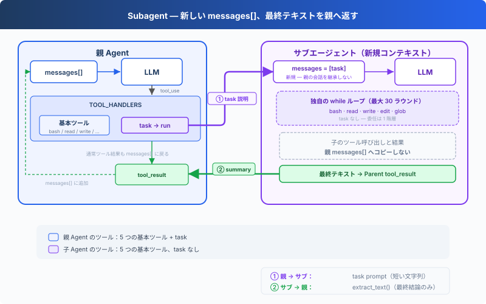

# s06: Subagent — サブタスクに独立したコンテキストを与える

[English](README.md) · [中文](README.zh.md) · [日本語](README.ja.md)

s01 → s02 → s03 → s04 → s05 → `s06` → [s07](../s07_skill_loading/) → s08 → ... → s16 → s17

> Subagent は新しい `messages[]` から始まる。最終テキストだけが親ループへ戻り、中間会話は親コンテキストへ入らない。
>
> **Harness レイヤー**: 委任 — 明確なサブタスクを別の会話コンテキストで処理する。

---

## 課題

Agent がバグを修正している。呼び出しチェーンを追うために多くのファイルを読み、すべてのツール呼び出しと結果が親の `messages[]` に残る。チェーンを把握した後は不要になる中間情報も、コンテキストを使い続ける。

---

## ソリューション



`task` を呼ぶと、新しい `messages[]` を使う入れ子の Agent Loop が同期実行される。ループが終了すると、最終テキストが親会話の tool result になる。

ここで分離するのはメッセージであり、プロセスやファイルシステムではない。親 Agent とサブエージェントは `WORKDIR` を共有するため、書き込みやコマンドは同じワークスペースへ作用する。サブエージェントは 5 つの基本ツールを持つが `task` はなく、親と同じ権限 Hooks とライフサイクル Hooks を使う。

---

## 仕組み

**run_subagent** は新しいメッセージリストを作り、入れ子のループを実行して、最終テキストを返す：

```typescript
const SUB_TOOLS = [...BASE_TOOLS]; // no task tool

async function run_subagent(prompt: string): Promise<string> {
    const messages = [{ role: "user", content: prompt }];

    for (let _ = 0; _ < 30; _++) {
        const response = await client.messages.create({
            model: MODEL, system: SUB_SYSTEM,
            messages, tools: SUB_TOOLS, max_tokens: 8000,
        });
        messages.push({ role: "assistant", content: response.content });
        const tool_calls = response.content.filter(
            (block) => block.type === "tool_use",
        );
        if (tool_calls.length === 0) {
            return extract_text(response.content) || "(no summary)";
        }

        const results = [];
        for (const block of tool_calls) {
            const output = await execute_tool(block, SUB_HANDLERS);
            results.push({ /* ... */ content: output });
        }
        messages.push({ role: "user", content: results });
    }

    return "Subagent stopped after 30 turns without a final answer.";
}
```

メイン Agent の呼び出しは、他のツールと同じ：

```typescript
const TASK_TOOL = {
    "name": "task",
    "description": "Run a subagent with fresh conversation context and return its final text.",
    "input_schema": {
        "type": "object",
        "properties": { prompt: { type: "string" } },
        "required": ["prompt"],
    },
};

const TOOLS = [...BASE_TOOLS, TASK_TOOL];
const TOOL_HANDLERS = { ...BASE_HANDLERS, task: run_subagent };
```

実際の境界は次のとおり：

| 決定 | 選択 | 理由 |
|------|------|------|
| 会話 | 新しい `messages[]` | 親の会話をサブエージェントへコピーしない |
| 実行 | 同じプロセスと `WORKDIR` | どちらのループからもファイル変更が見える |
| 戻り値 | 最終テキストのみ | 子のツール呼び出しと結果を親 messages へコピーしない |
| 委任の深さ | `SUB_TOOLS` に `task` なし | 本章では 1 階層の委任だけを許可 |
| ツールポリシー | Hooks を共有 | 親子で同じ権限チェックを使う |

親 Agent は他のツールと同じ handler map から `task` を実行する。サブエージェントは `SUB_SYSTEM`、`SUB_TOOLS`、ローカルな `messages` リストを使う。

---

## 試してみよう

```sh
cd learn-claude-code
npx tsx s06_subagent/code.ts
```

以下のプロンプトを試してみよう：

1. `Use a subtask to find what testing framework this project uses`（サブエージェントがファイルを読み、メイン Agent は結論のみ受け取る）
2. `Delegate: read all .ts files in agents/ and summarize what each one does`
3. `Use a task to create s06_subagent/example/string_tools.ts with a slugify(text: string) function, then verify it from the parent agent`

観察のポイント：`[Subagent started]` / `[Subagent done]` が表示されるか？ サブエージェントのツール呼び出しが `[sub] ...` と表示されるか？ 親 Agent は `task` が返した最終テキストだけを受け取るか？

---

## 次へ

Agent はタスクを分割できるようになった。しかし各タスクに必要な知識は異なる。フロントエンドコンポーネントの変更には React 規約が必要で、SQL を書くにはテーブル構造を知る必要がある。これらの知識をすべて system prompt に詰め込むと、コンテキストが溢れてしまう。

→ s07 Skill Loading：スキルをオンデマンドで注入する。system prompt にドキュメントを積み上げるのではなく、必要なときだけ読み込む。ファイルを読むのと同じくらい自然に。


<!-- translation-sync: zh@v2, en@v2, ja@v2 -->
