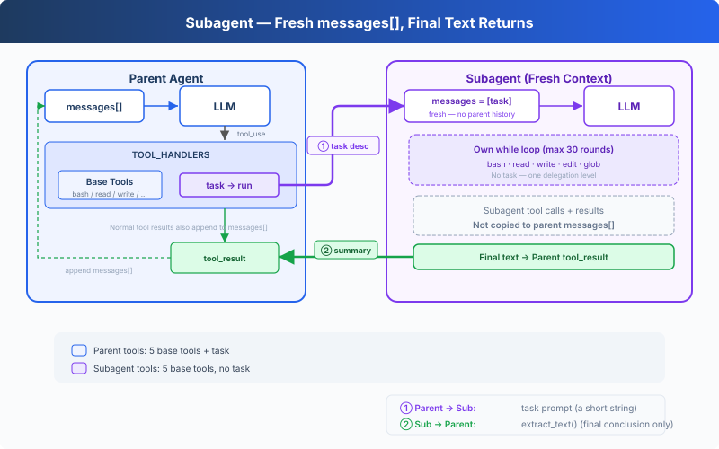

# s06: Subagent — Give a Subtask Its Own Context

[English](README.md) · [中文](README.zh.md) · [日本語](README.ja.md)

s01 → s02 → s03 → s04 → s05 → `s06` → [s07](../s07_skill_loading/) → s08 → ... → s16 → s17

> A subagent starts with a fresh `messages[]`. Its final text returns to the parent; its intermediate conversation does not.
>
> **Harness Layer**: Delegation — Run a focused task in a separate conversation context.

---

## The Problem

The Agent is fixing a bug. It reads many files to trace the call chain, and every tool call and result stays in the parent's `messages[]`. Once the call chain is understood, most of those intermediate details are no longer needed, but they still occupy context.

---

## The Solution



Calling `task` synchronously runs a nested agent loop with a fresh `messages[]`. When that loop finishes, its final text becomes the tool result in the parent conversation.

This is message isolation, not process or filesystem isolation. Parent and subagent run in the same Node.js process and share `WORKDIR`, so writes and commands still affect the same workspace. The subagent has the five base tools but no `task`, and its tool calls use the same permission and lifecycle hooks as the parent.

---

## How It Works

**run_subagent** creates the fresh message list, runs the nested loop, and returns the final text:

```typescript
const SUB_TOOLS = [...BASE_TOOLS]; // no task tool

async function run_subagent(prompt: string): Promise<string> {
    const messages = [{ role: "user", content: prompt }];

    for (let _ = 0; _ < 30; _++) {
        const response = await client.messages.create({
            model: MODEL, system: SUB_SYSTEM,
            messages, tools: SUB_TOOLS, max_tokens: 8000,
        });
        messages.push({ role: "assistant", content: response.content });
        const tool_calls = response.content.filter(
            (block) => block.type === "tool_use",
        );
        if (tool_calls.length === 0) {
            return extract_text(response.content) || "(no summary)";
        }

        const results = [];
        for (const block of tool_calls) {
            const output = await execute_tool(block, SUB_HANDLERS);
            results.push({ /* ... */ content: output });
        }
        messages.push({ role: "user", content: results });
    }

    return "Subagent stopped after 30 turns without a final answer.";
}
```

The main Agent calls it just like any other tool:

```typescript
const TASK_TOOL = {
    "name": "task",
    "description": "Run a subagent with fresh conversation context and return its final text.",
    "input_schema": {
        "type": "object",
        "properties": { prompt: { type: "string" } },
        "required": ["prompt"],
    },
};

const TOOLS = [...BASE_TOOLS, TASK_TOOL];
const TOOL_HANDLERS = { ...BASE_HANDLERS, task: run_subagent };
```

The boundary is:

| Decision | Choice | Reason |
|----------|--------|--------|
| Conversation | Fresh `messages[]` | Parent history is not copied into the subagent |
| Execution | Same process and `WORKDIR` | Filesystem changes remain visible to both loops |
| Return value | Final text only | Child tool calls and results are not copied into parent messages |
| Delegation depth | No `task` in `SUB_TOOLS` | This lesson permits one delegation level |
| Tool policy | Shared Hooks | Parent and subagent use the same permission checks |

The parent dispatches `task` through the same handler map as its other tools. The subagent uses `SUB_SYSTEM`, `SUB_TOOLS`, and its own local `messages` list.

---

## Try It

```sh
cd learn-claude-code
npx tsx s06_subagent/code.ts
```

Try these prompts:

1. `Use a subtask to find what testing framework this project uses` (sub-Agent reads files, main Agent receives only the conclusion)
2. `Delegate: read all .ts files in agents/ and summarize what each one does`
3. `Use a task to create s06_subagent/example/string_tools.ts with a slugify(text: string) function, then verify it from the parent agent`

What to watch for: Do `[Subagent started]` / `[Subagent done]` appear? Do subagent tool calls print as `[sub] ...`? Does the parent continue with only the final text returned by `task`?

---

## What's Next

The Agent can now break tasks apart. But different tasks require different knowledge: editing frontend components needs React conventions, writing SQL needs table schemas. Stuffing all this knowledge into the system prompt would blow up the context.

→ s07 Skill Loading: Inject skills on demand instead of piling documents into the system prompt. Load only when needed, as natural as reading a file.


<!-- translation-sync: zh@v2, en@v2, ja@v2 -->
