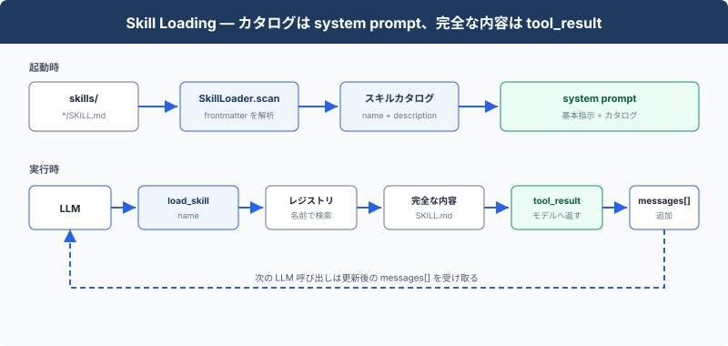

# s07: Skill Loading — 必要なときにスキルを読み込む

[English](README.md) · [中文](README.zh.md) · [日本語](README.ja.md)

s01 → s02 → s03 → s04 → s05 → s06 → `s07` → [s08](../s08_context_compact/) → s09 → ... → s16 → s17

> system prompt にはスキルカタログを入れ、`load_skill` は完全な `SKILL.md` を返す。
>
> **Harness レイヤー**：知識の読み込み — 利用可能なスキルをモデルに示し、名前で内容を読み込む。

---

## 課題

あるプロジェクトに React コンポーネント仕様、SQL スタイルガイド、API 設計ドキュメントがあるとする。開発中に Agent へこれらの規約を守らせたい場合、最も直接的な方法は、すべてを system prompt に入れることだ：

```typescript
const SYSTEM = (
    "You are a coding agent. "
    + readFileSync("docs/react-style.md", "utf8")
    + readFileSync("docs/sql-style.md", "utf8")
    + readFileSync("docs/api-design.md", "utf8")
);
```

この方法で Agent はすべての規約を読めるが、3 つの文書すべてが system prompt に固定され、現在のタスクに必要な文書だけを選べない。LLM を呼び出すたびに、3 つの文書の全文がモデルへ送られる。タスクが React コンポーネントの変更だけなら、必要なのは React コンポーネント仕様だけである。無関係な SQL スタイルガイドと API 設計ドキュメントも入力 token とコンテキストウィンドウを使うため、コード、会話、tool result に使える領域が減る。

---

## ソリューション



起動時に `SkillLoader` が `skills/*/SKILL.md` を走査し、YAML frontmatter の `name` と `description` を読み取って、カタログを system prompt に追加する。完全な指示が必要になると、モデルは `load_skill(name)` を呼ぶ。返された `SKILL.md` は `tool_result` としてメッセージリストへ追加される。

| 内容 | モデル入力での位置 | 追加時点 |
|------|--------------------|----------|
| スキル名と説明 | system prompt | 起動時 |
| 完全な `SKILL.md` | `tool_result` | `load_skill` 呼び出し時 |

---

## 仕組み

各スキルは `SKILL.md` を持つディレクトリである：

```text
skills/
  agent-builder/SKILL.md
  code-review/SKILL.md
  mcp-builder/SKILL.md
  pdf/SKILL.md
```

### スキルを走査する

```typescript
class SkillLoader {
    scan() {
        this.skills = {};
        const skills_root = resolve(this.skills_dir);
        for (const manifest of globSync("*/SKILL.md", { cwd: this.skills_dir }).sort()) {
            const manifest_path = resolve(this.skills_dir, manifest);
            if (!isFile(manifest_path)
                    || !isRelativeTo(skills_root, resolve(manifest_path))) {
                continue;
            }
            const content = readFileSync(manifest_path, "utf8");
            const [metadata, body] = this.parse_frontmatter(content);
            const raw_name = metadata.name;
            let name = typeof raw_name === "string" ? raw_name.trim() : "";
            name = name || basename(dirname(manifest_path));
            const raw_description = metadata.description;
            let description = typeof raw_description === "string"
                ? raw_description.trim()
                : "";
            description = description || body.split("\n", 1)[0];
            description = String(description).replace(/^[# ]+/, "").split(/\s+/).filter(Boolean).join(" ");
            this.skills[name] = {
                name,
                description,
                content,
            };
        }
    }
}
```

`catalog()` は名前と説明だけを返す：

```text
- code-review: Perform thorough code reviews...
- pdf: Process PDF files...
```

### system prompt を組み立てる

```typescript
const ENVIRONMENT_PROMPT = (
    process.platform === "win32"
    ? "Windows: the bash tool runs through cmd.exe; use cmd.exe syntax, not Unix "
      + "Bash or PowerShell syntax, and prefer dedicated file tools for file operations"
    : "Unix-like: the bash tool runs the system shell"
);

function build_system_prompt(): string {
    return (
        `You are a coding agent at ${WORKDIR}. Environment: ${ENVIRONMENT_PROMPT}. `
        + "Use tools to solve tasks. "
        + "Act, don't explain.\n\n"
        + `Skills available:\n${SKILL_LOADER.catalog()}\n\n`
        + "Use load_skill to read the full instructions when a skill applies."
    );
}
```

固定された Agent の指示と、起動時に見つかったスキルカタログをこの関数で組み合わせる。

### 完全な内容を読み込む

```typescript
load(name: string): string {
    const skill = this.skills[name];
    if (skill) {
        return skill.content;
    }
    const available = Object.keys(this.skills).join(", ") || "none";
    return `Error: Unknown skill '${name}'. Available: ${available}`;
}
```

`name` は起動時に作られたレジストリの検索に使われ、ファイルパスとして解釈されない。ツールが返ると、既存の Agent Loop が内容を新しい `tool_result` メッセージとして追加する。

---

## 試してみよう

```sh
cd learn-claude-code
npx tsx s07_skill_loading/code.ts
```

以下の prompt を試す：

1. `What skills are available?`
2. `Load the code-review skill and follow its instructions`
3. `Review README.md and load the relevant skill first`

system prompt にカタログだけが入り、`load_skill` の呼び出し後に完全な `SKILL.md` が現れることを確認する。

---

## 次へ

ツール呼び出しが増えると、`messages[]` には以前のファイル内容やツール結果が残る。

s08 Context Compact → 過去のメッセージを短くし、後続の呼び出しで使えるコンテキストを確保する。


<!-- translation-sync: zh@v6, en@v6, ja@v6 -->
