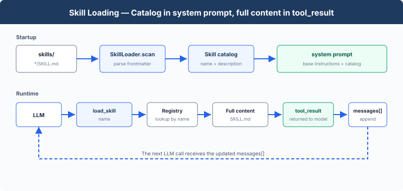

# s07: Skill Loading — Load Skills When Needed

[English](README.md) · [中文](README.zh.md) · [日本語](README.ja.md)

s01 → s02 → s03 → s04 → s05 → s06 → `s07` → [s08](../s08_context_compact/) → s09 → ... → s16 → s17

> The system prompt contains the skill catalog; `load_skill` returns the full `SKILL.md`.
>
> **Harness Layer**: Knowledge loading — show the model which skills exist, then load one by name.

---

## The Problem

Suppose a project has a React component specification, a SQL style guide, and an API design document. We want the Agent to follow these rules during development, so the most direct approach is to put all of them into the system prompt:

```typescript
const SYSTEM = (
    "You are a coding agent. "
    + readFileSync("docs/react-style.md", "utf8")
    + readFileSync("docs/sql-style.md", "utf8")
    + readFileSync("docs/api-design.md", "utf8")
);
```

This approach lets the Agent read every specification, but it fixes all three documents in the system prompt instead of selecting only the one needed for the current task. Every LLM call sends the full text of all three documents to the model. When the task only changes React components, only the React specification is relevant; the SQL style guide and API design document still consume input tokens and context-window space that could hold code, conversation, and tool results.

---

## The Solution



At startup, `SkillLoader` scans `skills/*/SKILL.md`, reads `name` and `description` from YAML frontmatter, and adds that catalog to the system prompt. When the model needs the full instructions, it calls `load_skill(name)`; the returned `SKILL.md` is appended to the message list as a `tool_result`.

| Content | Model input | Added |
|---------|-------------|-------|
| Skill name and description | system prompt | At startup |
| Full `SKILL.md` | `tool_result` | When `load_skill` is called |

---

## How It Works

Each skill is a directory containing `SKILL.md`:

```text
skills/
  agent-builder/SKILL.md
  code-review/SKILL.md
  mcp-builder/SKILL.md
  pdf/SKILL.md
```

### Scan Skills

```typescript
class SkillLoader {
    scan() {
        this.skills = {};
        const skills_root = resolve(this.skills_dir);
        for (const manifest of globSync("*/SKILL.md", { cwd: this.skills_dir }).sort()) {
            const manifest_path = resolve(this.skills_dir, manifest);
            if (!isFile(manifest_path)
                    || !isRelativeTo(skills_root, resolve(manifest_path))) {
                continue;
            }
            const content = readFileSync(manifest_path, "utf8");
            const [metadata, body] = this.parse_frontmatter(content);
            const raw_name = metadata.name;
            let name = typeof raw_name === "string" ? raw_name.trim() : "";
            name = name || basename(dirname(manifest_path));
            const raw_description = metadata.description;
            let description = typeof raw_description === "string"
                ? raw_description.trim()
                : "";
            description = description || body.split("\n", 1)[0];
            description = String(description).replace(/^[# ]+/, "").split(/\s+/).filter(Boolean).join(" ");
            this.skills[name] = {
                name,
                description,
                content,
            };
        }
    }
}
```

`catalog()` returns only names and descriptions:

```text
- code-review: Perform thorough code reviews...
- pdf: Process PDF files...
```

### Build the System Prompt

```typescript
const ENVIRONMENT_PROMPT = (
    process.platform === "win32"
    ? "Windows: the bash tool runs through cmd.exe; use cmd.exe syntax, not Unix "
      + "Bash or PowerShell syntax, and prefer dedicated file tools for file operations"
    : "Unix-like: the bash tool runs the system shell"
);

function build_system_prompt(): string {
    return (
        `You are a coding agent at ${WORKDIR}. Environment: ${ENVIRONMENT_PROMPT}. `
        + "Use tools to solve tasks. "
        + "Act, don't explain.\n\n"
        + `Skills available:\n${SKILL_LOADER.catalog()}\n\n`
        + "Use load_skill to read the full instructions when a skill applies."
    );
}
```

This function combines the fixed Agent instructions with the catalog found at startup.

### Load Full Content

```typescript
load(name: string): string {
    const skill = this.skills[name];
    if (skill) {
        return skill.content;
    }
    const available = Object.keys(this.skills).join(", ") || "none";
    return `Error: Unknown skill '${name}'. Available: ${available}`;
}
```

`name` looks up the startup registry; it is not interpreted as a file path. After the tool returns, the existing Agent Loop appends its content as a new `tool_result` message.

---

## Try It

```sh
cd learn-claude-code
npx tsx s07_skill_loading/code.ts
```

Try these prompts:

1. `What skills are available?`
2. `Load the code-review skill and follow its instructions`
3. `Review README.md and load the relevant skill first`

Check that the system prompt contains only the catalog and that the full `SKILL.md` appears after `load_skill` is called.

---

## What's Next

As tool calls accumulate, `messages[]` retains earlier file contents and tool results.

→ s08 Context Compact: shorten earlier messages and keep context available for later calls.


<!-- translation-sync: zh@v6, en@v6, ja@v6 -->
