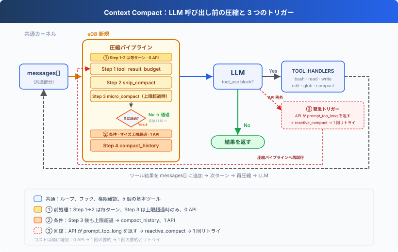
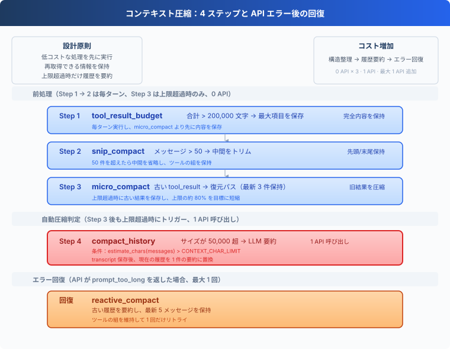
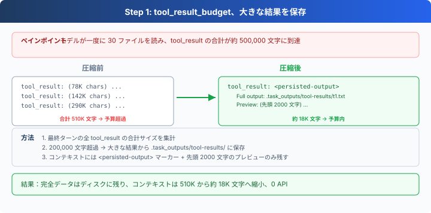
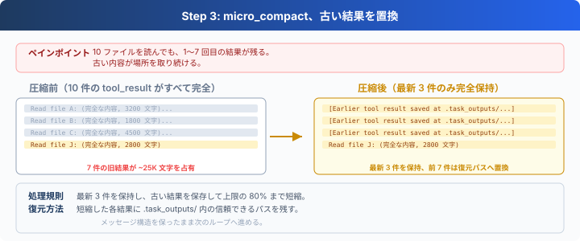
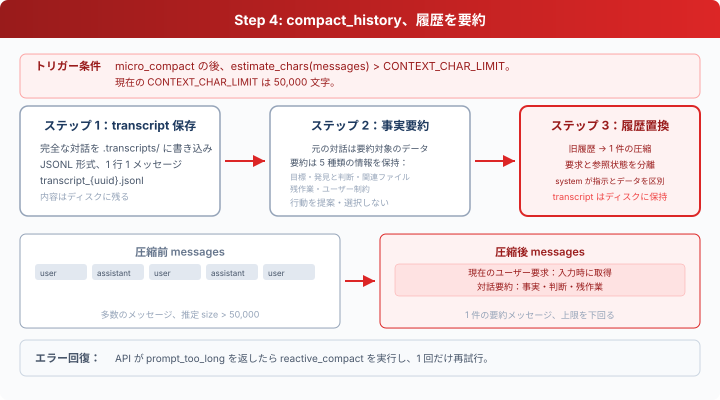

# s08: Context Compact：コンテキストが満杯になる前に整理する

[English](README.md) · [中文](README.zh.md) · [日本語](README.ja.md)

s01 → s02 → s03 → s04 → s05 → s06 → s07 → `s08` → [s09](../s09_memory/) → s10 → ... → s16 → s17

> *「コンテキストには上限があるため、空きを作る仕組みが必要になる。」* 4 つの処理を低コストな順に実行します。
>
> **Harness レイヤー**：圧縮によって、限られたコンテキストを長いタスクでも使い続けられます。


Agent が作業を続けると、読み込んだファイル、コマンド結果、モデルの応答がすべて `messages` に残ります。履歴はやがてモデルのコンテキスト上限を超えます。

このレッスンでは、4 ステップの圧縮パイプラインを実装します。まず再取得できるツール結果を整理し、それでも足りない場合にだけ履歴を要約します。




## コンテキストを理解する

コンテキストウィンドウは、モデルが現在使っている下書き用紙と考えられます。ユーザーメッセージ、モデルの応答、`tool_use`、`tool_result` が順番に書き込まれます。モデルはタスクを続けるたびに、その内容を読み直します。

下書き用紙の大きさは固定です。上限を超えると API はリクエストを拒否し、`prompt_too_long` を返します。コーディングタスクでは、ツール結果が多くの領域を占めます。

- 長いファイルを読むと、その内容がコンテキストに入ります。
- テストやビルドのログは、一度に数十 KB 追加されることがあります。
- 多数のファイルを検索すると、結果が次々に追加されます。

タスクが続くほど `messages` は大きくなります。圧縮は、その増加を抑えながら、現在の目標、ユーザーの制約、進行中の作業をできるだけ保持します。


## ツール結果から整理する理由

履歴全体の要約はコンテキストを大きく縮められますが、細部が失われ、モデル呼び出しも 1 回増えます。

ツール結果には、先に処理しやすい性質があります。

1. 大きなファイル結果はディスクに保存し、必要なときに読み直せます。
2. 古いコマンドは再実行できます。
3. 最新の結果ほど現在の作業に近い傾向があります。
4. テキストの切り詰めと構造の調整にはモデル呼び出しが不要です。

そのため、情報損失とコストが小さい順に、保存、切り詰め、古い結果の置換、履歴の要約を行います。




## ステップ 1：tool_result_budget

1 回のモデル応答が複数のツールを要求することがあります。実行後の `tool_result` は、最後の user メッセージにまとめて書き込まれます。合計が `200_000` 文字を超えると、`tool_result_budget` は大きな結果から順に処理します。

`LARGE_RESULT_CHAR_LIMIT = 30000` を超える結果は、次の場所に完全な形で保存されます。

```text
.task_outputs/tool-results/<tool_use_id>.txt
```

コンテキストには、ファイルパスと先頭 2000 文字のプレビューを残します。



中心となるループは、結果を大きい順に保存します。

```typescript
const blocks = content.filter((block) =>
    block !== null && typeof block === "object" && !Array.isArray(block)
    && block.type === "tool_result");
let total = blocks.reduce((sum, block) => sum + String(block.content ?? "").length, 0);

const ranked = [...blocks].sort(
    (a, b) => String(b.content ?? "").length - String(a.content ?? "").length,
);
for (const block of ranked) {
    if (total <= max_chars) {
        break;
    }
    const text = String(block.content ?? "");
    if (text.length <= this.LARGE_RESULT_CHAR_LIMIT) {
        continue;
    }
    block.content = this.persist_large_output(
        block.tool_use_id ?? "unknown", text);
    total = blocks.reduce((sum, item) => sum + String(item.content ?? "").length, 0);
}
```

このステップが対象にするのは、最新のツール結果だけです。完全な出力は保存先から再取得できるため、最初に実行する処理に適しています。


## ステップ 2：snip_compact

履歴が 50 メッセージを超えると、`snip_compact` は完全な履歴を `.transcripts/` に保存してから、先頭 3 件と最新 46 件を保持します。残り 1 件は archive marker に使い、削除した件数と完全な transcript の保存先を記録します。

```typescript
let head_end = 3;
let tail_start = messages.length - (max_messages - head_end - 1);

if (this.has_tool_use(messages[head_end - 1])) {
    while (head_end < tail_start
           && this.is_tool_result(messages[head_end])) {
        head_end += 1;
    }
}

if (tail_start > 0
        && this.is_tool_result(messages[tail_start])
        && this.has_tool_use(messages[tail_start - 1])) {
    tail_start -= 1;
}

const transcript = this.write_transcript(messages);
const marker = { role: "user", content:
    `[${tail_start - head_end} messages archived at ${transcript}]` };
messages = [...messages.slice(0, head_end), marker, ...messages.slice(tail_start)];
```

切断位置では、`assistant(tool_use)` と `user(tool_result)` の組を保護します。対応するツール呼び出しがない孤立した結果を含むと、次の API リクエストは無効になります。

ツール呼び出しが繰り返されると、現在の要求がアーカイブ対象の中間領域へ移ることがあります。実際に切り詰めた後、`prepare` は元のユーザーメッセージまたは既存の `Current user request` マーカーがまだ見えるかを確認します。どちらも残っていなければ、処理を続ける前に `active_request` を一度だけ追加します。

このステップはメッセージ数を抑えます。保持されたメッセージ内のツール結果は、まだ長い可能性があります。


## ステップ 3：micro_compact

最初の 2 ステップの後、`prepare` は残りのコンテキストサイズを推定し、`CONTEXT_CHAR_LIMIT` を超えている場合にだけ `micro_compact` を実行します。モデルがすでに読んだ結果については最新 3 件を残し、それより古く 120 文字を超える結果を、コンテキストが上限の 80% に近づくまで順に短くします。古い結果は置換前に完全な内容をディスクへ保存するため、各プレースホルダーには復元用のパスが残ります。



```typescript
const unseen = this.unseen_tool_result_positions(messages);
const consumed = results.filter((entry) => !unseen.has(entry.slice(0, 2).join(":")));

for (const [, , block] of consumed.slice(0, -this.KEEP_RECENT_RESULTS)) {
    if (this.estimate_chars(messages) <= target_chars) {
        break;
    }
    const content = String(block.content ?? "");
    if (content.length <= 120) {
        continue;
    }
    let saved_path = this.persisted_output_path(content);
    if (!saved_path) {
        saved_path = this.save_output(block.tool_use_id, content);
    }
    block.content = `[Earlier tool result saved at ${saved_path}]`;
}
```

新しい結果は通常、モデルが一度読むまで完全な形で保持されます。未読の最新バッチだけでコンテキストを超える場合、`fit_tool_results` は大きな結果を保存し、1,000 文字の preview と完全な出力へのパスを残します。これにより、モデルが新しい結果を見る前に履歴全体を要約する事態を避けます。

最初の 2 ステップは毎ラウンド実行され、ステップ 3 はコンテキストが上限を超えた場合にだけ実行されます。3 ステップとも決定的で復元可能なテキスト処理と構造操作であり、追加の API 呼び出しは発生しません。


## ステップ 4：compact_history

`micro_compact` と `fit_tool_results` の後、コードは `estimate_chars(messages)` でコンテキストを再び推定します。

```typescript
const CONTEXT_CHAR_LIMIT = 50000;

function estimate_chars(messages) {
    return json_dumps(messages).length;
}
```

文字数がまだ `CONTEXT_CHAR_LIMIT` を超えている場合、`compact_history` は 4 つの処理を行います。

1. 完全なメッセージ履歴を `.transcripts/` に書き込みます。
2. モデルに事実だけの状態要約を依頼します。
3. 入力時に取得した現在の要求を要約と明確に分けます。
4. 現在の履歴を 1 件の `[Compacted]` メッセージに置き換えます。



```typescript
async function compact_history(messages, active_request) {
    const transcript = this.write_transcript(messages);
    console.log(`[transcript saved: ${transcript}]`);
    const summary = await this.summarize_history(messages);
    return [this.summary_message(
        "Compacted", active_request, summary, transcript)];
}
```

要約呼び出しは、履歴内の指示を実行せず、目標、ファイル、判断、残作業、ユーザー制約を整理するようモデルに求めます。ツール結果も `role=user` を使うため、CLI は `active_request` を Agent Loop に直接渡します。圧縮後のメッセージでは、現在の要求を `Current user request`、要約を `Conversation summary` に分け、完全な transcript のパスも残します。

このレッスンでは文字数を発火条件として使い、関連するしきい値も同じ単位で扱います。


## 順序を固定する理由

パイプラインは次の順序で処理し、必要な場合にだけ情報を失う要約へ進みます。

```typescript
messages = this.tool_result_budget(messages);
const before_snip = messages;
messages = this.snip_compact(messages);
const active_request_marker = (
    `Current user request:\n${active_request}\n\n` +
    "Conversation summary (reference only):"
);
if (messages !== before_snip
        && !messages.some((message) =>
            message.role === "user"
            && typeof message.content === "string"
            && (message.content === active_request
                || message.content.includes(active_request_marker)))) {
    messages.push({ role: "user", content: active_request });
}
if (this.estimate_chars(messages) > this.CONTEXT_CHAR_LIMIT) {
    const target = Math.trunc(this.CONTEXT_CHAR_LIMIT * 0.8);
    messages = this.micro_compact(messages, target);
    if (this.estimate_chars(messages) > this.CONTEXT_CHAR_LIMIT) {
        messages = this.fit_tool_results(messages, target);
    }
    if (this.estimate_chars(messages) > this.CONTEXT_CHAR_LIMIT) {
        messages = await this.compact_history(messages, active_request);
    }
}
```

この順序には 2 つの条件があります。

1. ステップ 1 と 2 は毎ラウンド実行され、ステップ 3 は上限を超えた場合だけ実行されます。API リクエストを追加するのはステップ 4 だけです。
2. 短縮した各ツール結果には `.task_outputs/tool-results/` 内の信頼できるパスを残します。それでも上限を超える場合にだけ、モデルによる履歴要約へ進みます。

各ラウンドは、コストが低く情報を再取得しやすい処理から始まります。


## API に拒否された後の回復

文字数はモデルが使う token 数の推定値です。そのため API が `prompt_too_long` を返す可能性は残ります。`reactive_compact` は transcript を保存し、古い履歴を要約して、最新 5 メッセージを保持します。

```typescript
let tail_start = Math.max(0, messages.length - this.KEEP_RECENT_MESSAGES);
if (tail_start > 0
        && this.is_tool_result(messages[tail_start])
        && this.has_tool_use(messages[tail_start - 1])) {
    tail_start -= 1;
}

const old_history = tail_start ? messages.slice(0, tail_start) : messages;
const summary = await this.summarize_history(old_history);
const message = this.summary_message(
    "Reactive compact", active_request, summary, transcript);
messages = tail_start ? [message, ...messages.slice(tail_start)] : [message];
```

この切断位置でもツール呼び出しと結果の組を分割せず、現在のユーザー要求は `active_request` で明示的に渡されます。`MAX_REACTIVE_RETRIES = 1` により、回復処理は 1 回だけ許可されます。もう一度コンテキスト長のエラーを受けた場合は、例外を呼び出し元へ返します。


## Agent Loop に組み込む

```typescript
async function agent_loop(messages, active_request) {
    while (true) {
        const prepared = await COMPACTOR.prepare(messages, active_request);
        messages.splice(0, messages.length, ...prepared.slice());

        try {
            const response = await client.messages.create({
                model: MODEL, system: SYSTEM, messages,
                tools: TOOLS, max_tokens: 8000 });
            reactive_retries = 0;
        } catch (error) {
            const message = String(error).toLowerCase();
            const too_long = message.includes("prompt_too_long")
                        || message.includes("too many tokens");
            if (too_long && reactive_retries < MAX_REACTIVE_RETRIES) {
                const compacted = await COMPACTOR.reactive_compact(
                    messages, active_request);
                messages.splice(0, messages.length, ...compacted.slice());
                reactive_retries += 1;
                continue;
            }
            throw error;
        }
    }
}
```

すべてのモデル呼び出しが同じパイプラインを通ります。CLI は `query` を追加した後に `agent_loop(history, query)` を呼びます。実際に切り詰められ、見えるコピーがすべて削除された場合にだけ、`prepare` は `active_request` を追加し直します。そのため、圧縮を繰り返しても現在の要求は失われません。`micro_compact` の後も上限を超える場合、または API が拒否した場合にだけ、コードはモデルへ要約を依頼します。


## compact ツール

自動しきい値が判断できるのは、コンテキストの大きさだけです。ある段階を終え、次の段階に要約だけを引き継げばよいとモデルが判断したとき、`compact` を呼び出せます。

```typescript
{ "name": "compact",
  "description": "Summarize earlier conversation to free context space." }
```

1 回の応答には、ファイル書き込みと圧縮のように複数のツール呼び出しが含まれることがあります。Harness はまず一括処理をすべて実行し、各 `tool_use` に対応する `tool_result` を追加します。そのターンが完結してから要約します。

```typescript
const tool_calls = response.content.filter((block) => block.type === "tool_use");
const results = [];
let compact_requested = false;

for (const block of tool_calls) {
    let output;
    if (block.name === "compact") {
        output = "Compaction requested after this tool batch.";
        compact_requested = true;
    } else {
        output = await execute_tool(block);
    }
    results.push({ type: "tool_result", tool_use_id: block.id,
                    content: output });
}

messages.push({ role: "user", content: results });

if (compact_requested) {
    const compacted = await COMPACTOR.compact_history(messages, active_request);
    messages.splice(0, messages.length, ...compacted.slice());
}
```

これにより孤立したツール結果が残りません。また、圧縮前に実行したファイル書き込みなどの記録も保持されるため、モデルが同じ副作用を繰り返すことを防げます。


## このレッスンで追加するもの

| コンポーネント | 共通の実行ループ | s08 で追加 |
| --- | --- | --- |
| Agent Loop | モデルを呼び出し、ツールを実行し、結果を追加 | 各モデル呼び出しの前に `COMPACTOR.prepare()` を実行 |
| Hooks | 権限確認、ツールログ、結果処理 | 同じツール実行入口を維持 |
| コンテキスト | `messages` に追加 | 大きな結果の保存、古い履歴のアーカイブ、要約、長さエラー後の 1 回の再試行 |
| ツール | 5 個の基本ツール | `compact` を追加し、合計 6 個 |

> **s09 との境界：** s08 は現在のセッションにある有限のコンテキストを管理し、再取得できる詳細を圧縮できます。s09 は、圧縮後や次のセッションにも残す情報を保存します。


## 試してみる

```bash
cd learn-claude-code
npx tsx s08_context_compact/code.ts
```

### 実験 1：古い結果を置き換える

```text
s01_agent_loop から s05_todo_write までの README.md を読み、
各ファイルの最上位見出しを比較して、命名の規則をまとめてください。
```

このタスクでは少なくとも 5 件のファイル結果が生成されます。新しい結果は通常、モデルが初めて読むまで完全に保持されます。未読結果自体が大きすぎる場合は、preview と復元パスを残します。以降のターンでは、すでに読まれた最新 3 件を残し、それより前の長い結果は `[Earlier tool result saved at ...]` 参照に変わります。

### 実験 2：大きな結果を保存する

```text
web/src/data/generated/docs.json のデータ構造を調べ、
1 件のレッスン記録に含まれる主なフィールドを説明してください。
```

ファイルが 1 ラウンドの予算を超える場合でもタスクは続行でき、完全な結果が `.task_outputs/tool-results/` に保存されます。

### 実験 3：自動要約を発火させる

```text
s08_context_compact/code.ts と s09_memory/code.ts を比較し、
現在のコンテキストと永続メモリの管理方法を説明してください。
```

ファイル結果によって `estimate_chars(messages)` が 50000 を超えると、ターミナルに `[auto compact]` と transcript のパスが表示されます。次の呼び出しは `[Compacted]` の要約から続行します。

`.transcripts/` と `.task_outputs/tool-results/` を確認すると、履歴の保存と大きな結果の転送をそれぞれ観察できます。


## 次へ

コンテキスト圧縮により、Agent は限られたウィンドウでも長いタスクを続けられます。圧縮後や次のセッションにも残す情報には、独立した永続メモリが必要です。

s09 Memory では、メモリの書き込み、検索、整理を実装します。

<!-- translation-sync: zh@v8, en@v8, ja@v8 -->
