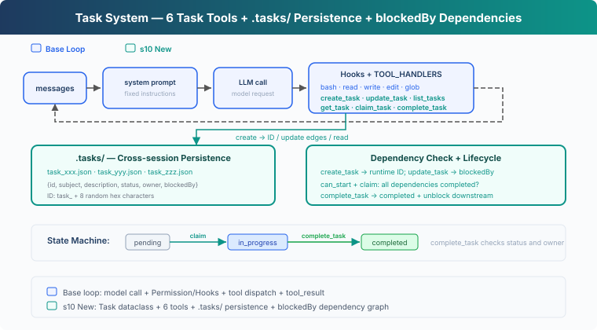
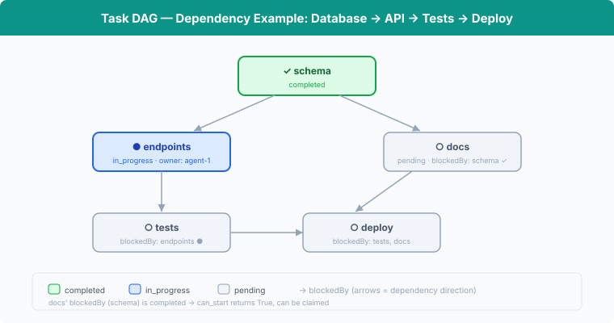

# s10: Task System — From an Execution Checklist to Coordinated Task State

[English](README.md) · [中文](README.zh.md) · [日本語](README.ja.md)

s01 → ... → s08 → s09 → `s10` → [s11](../s11_background_tasks/) → s12 → ... → s16 → s17

> *"Break big goals into small tasks, order them, persist"* — File-persisted task graph, the foundation for multi-agent collaboration.
>
> **Harness Layer**: Tasks — Persisted goals, recoverable progress.

---

## The Problem

s05's TodoWrite lets an agent record the steps of its current task. Each checklist item has content and a status, helping the agent keep track of what remains.

When a project is split into three tasks—creating database tables, writing an API, and adding tests—the Harness also needs to know how they relate: the API must wait for the database tables, and the tests must wait for a stable API. It also needs to record who is responsible for each task.

TodoWrite does not record these dependencies or assignments. It can show that "write the API" is unfinished, but the Harness cannot use that information to decide whether the task is ready to start.

This chapter adds a Task System. Each task has its own ID and status; `blockedBy` records prerequisites, and `owner` records the agent responsible for the task.

---

## The Solution



The code keeps S04's five base tools, Permission, Hooks, and shared `execute_tool`, then adds 6 task tools, persistence in the `.tasks/` directory, and `blockedBy` dependency checks.

TodoWrite vs Task System:

| | TodoWrite (s05) | Task System (s10) |
|---|---|---|
| Role | Execution checklist for the current task | Recoverable task system |
| Storage | In-process / session state | `.tasks/{id}.json` |
| Dependencies | None | `blockedBy` dependency graph |
| Lifecycle | Current session / current task | Cross-session |
| Coordination | No task claiming | `owner` / claim |
| Status | pending / in_progress / completed | pending / in_progress / completed |
| Granularity | The agent's own steps | Tasks that can be claimed, tracked, and unblocked |
| Update contract | Replace the whole checklist | Create/get/update/list individual records |

---

## How It Works



### Task: Data Structure

Each task is a JSON file, stored in the `.tasks/` directory:

```typescript
class Task {
  id: string;
  subject: string;
  description: string;
  status: string;          // pending | in_progress | completed
  owner: string | null;    // Agent responsible for this task
  blockedBy: string[];     // List of dependency task IDs
}
```

IDs use the `task_` prefix followed by 8 random hexadecimal characters. Files are created exclusively; an existing ID is discarded and regenerated.

`TaskStore` validates task IDs and reads and writes the JSON files. `TASKS = TaskStore(TASKS_DIR)` is the store used by this chapter.

### create_task: Create Tasks

```typescript
function create_task(subject: string, description = ""): Task {
  return TASKS.create(subject, description);
}
```

`TaskStore.create` checks the subject, allocates a random ID, and writes `.tasks/{id}.json`. A new task always starts with an empty `blockedBy` list. The tool result returns the runtime-generated ID to the model.

### update_task: Add Dependencies with Returned IDs

```typescript
function update_task(task_id: string, addBlockedBy: string[]): Task {
  return TASKS.update_dependencies(task_id, addBlockedBy);
}
```

Task graph construction uses two phases: create every node first, then call `update_task` with the IDs returned by `create_task` to add edges. This matters when the model emits several tool calls in one response: sibling calls are formed before any tool result exists, so one `create_task` call cannot consume another call's newly generated ID.

`update_task` validates the entire change before saving it. The target and dependencies must exist, the target must still be pending and unowned, and the new edges must not introduce self-dependencies or cycles. Repeating an existing edge is safe and does not duplicate it.

### can_start: Dependency Check

A task can only start after all its `blockedBy` dependencies are **completed**:

```typescript
function can_start(task_id: string): boolean {
  return incomplete_dependencies(load_task(task_id)).length === 0;
}
```

`incomplete_dependencies` loads each prerequisite. A task cannot be claimed if any prerequisite is not completed or its file no longer exists.

### claim_task: Claim a Task

When the agent starts working on a task, it calls `claim_task`: sets `owner`, changes status from `pending` → `in_progress`. The `owner` field records who claimed the task:

```typescript
function claim_task(task_id: string, owner = "agent"): string {
  const task = load_task(task_id);
  if (task.status !== "pending") {
    return `Task ${task_id} is ${task.status}, cannot claim`;
  }
  const dependencies = incomplete_dependencies(task);
  if (dependencies.length) return `Blocked by: ${dependencies}`;
  task.owner = owner;
  task.status = "in_progress";
  TASKS.save(task);
  return `Claimed ${task_id} (${task.subject})`;
}
```

The claim is rejected if the task is not pending or its dependencies are incomplete. S10 only updates task state sequentially.

### complete_task: Complete and Unblock

When a task is done, set it to `completed`. Simultaneously scan all other tasks to find downstream tasks that were **just unblocked**:

```typescript
function complete_task(task_id: string, owner = "agent"): string {
  const task = load_task(task_id);
  if (task.status !== "in_progress") {
    return `Task ${task_id} is ${task.status}, cannot complete`;
  }
  if (task.owner !== owner) {
    return `Task ${task_id} is owned by ${task.owner}, not ${owner}`;
  }
  const ready_before = new Set(
    list_tasks()
      .filter((t) => t.status === "pending" && t.blockedBy.length && can_start(t.id))
      .map((t) => t.id),
  );
  task.status = "completed";
  TASKS.save(task);
  const unblocked = list_tasks()
    .filter((t) => (
      t.status === "pending" && t.blockedBy.length
      && !ready_before.has(t.id) && can_start(t.id)
    ))
    .map((t) => t.subject);
  let msg = `Completed ${task_id} (${task.subject})`;
  if (unblocked.length) msg += `\nUnblocked: ${unblocked.join(", ")}`;
  return msg;
}
```

After completing "schema", `can_start` returns True for "endpoints" and "docs"; they can begin.

### get_task: View Full Details

`list_tasks` only shows a one-line summary. `get_task` returns the full task JSON, including description and dependency details. When recovering across sessions, the agent needs to read the full description to continue work:

```typescript
function get_task(task_id: string): string {
  const task = load_task(task_id);
  return JSON.stringify(asdict(task), null, 2);
}
```

### State Machine: Two Actions, Three States

```
pending ──claim──→ in_progress ──complete──→ completed
```

Here `claim` / `complete` are actions, while `pending` / `in_progress` / `completed` are states:

- **claim_task**: `pending` → `in_progress`. Sets owner, begins work.
- **complete_task**: `in_progress` → `completed`. Marks the task done and unblocks downstream.

### Putting It Together

```typescript
// Phase 1: create every node and receive its runtime ID
const schema = create_task("setup database schema");
const endpoints = create_task("create API endpoints");
const tests = create_task("write tests");
const docs = create_task("write docs");

// Phase 2: add edges using those returned IDs
update_task(endpoints.id, [schema.id]);
update_task(tests.id, [endpoints.id]);
update_task(docs.id, [schema.id]);

// Agent claims the first available task
claim_task(schema.id);       // ✓ Claimed (no dependencies)
complete_task(schema.id);    // ✓ Completed → unblocks endpoints, docs

claim_task(endpoints.id);    // ✓ Claimed (schema completed)
complete_task(endpoints.id); // ✓ Completed → unblocks tests

claim_task(docs.id);         // ✓ Claimed (schema completed)
complete_task(docs.id);      // ✓ Completed

claim_task(tests.id);        // ✓ Claimed (endpoints completed)
complete_task(tests.id);     // ✓ Completed
```

Each `create_task` writes a JSON file; `update_task`, `claim_task`, and `complete_task` update it. Across sessions, the `.tasks/` directory persists — the agent reads the files to recover progress.

---

## Try It

```sh
cd learn-claude-code
npx tsx s10_task_system/code.ts
```

Try these prompts:

1. `Create tasks: setup database schema, create API endpoints (depends on schema), write tests (depends on endpoints), write docs (depends on schema)`
2. `List all tasks and their statuses`
3. `Claim the first unblocked task and complete it`
4. `List tasks again — which ones are now unblocked?`

What to observe: Are JSON files generated in the `.tasks/` directory? After completing a task, are the blocked tasks unblocked?

---

## What's Next

The task graph is in place, but full test suites, dependency installation, and deployment commands can take a long time. When these commands run synchronously, the Agent Loop remains blocked in the current tool call and cannot continue until the command finishes.

s11 Background Tasks → Slow operations run in the background. The Agent Loop can continue processing other tasks and receives a notification when the background work finishes.


<!-- translation-sync: zh@v5, en@v5, ja@v5 -->
