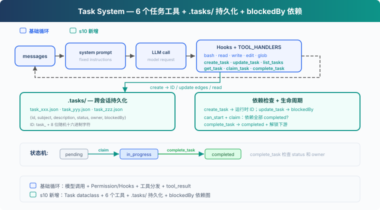
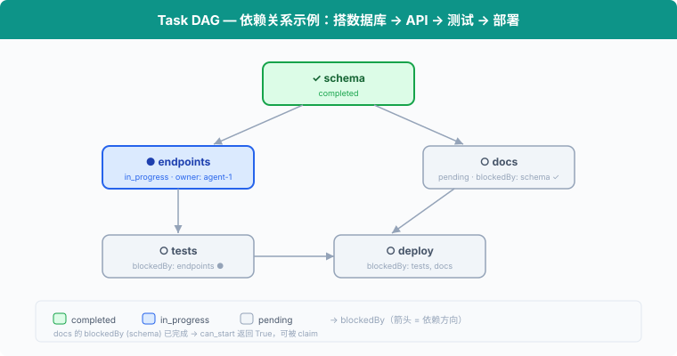

# s10: Task System — 从执行清单到可协调的任务状态

[English](README.md) · [中文](README.zh.md) · [日本語](README.ja.md)

s01 → ... → s08 → s09 → `s10` → [s11](../s11_background_tasks/) → s12 → ... → s16 → s17

> *"大目标拆成小任务, 排好序, 持久化"* — 文件持久化的任务图, 多 agent 协作的基础。
>
> **Harness 层**: 任务 — 持久化的目标, 可恢复的进度。

---

## 问题

s05 的 TodoWrite 让 Agent 记录当前任务的执行步骤。清单中的每一项只有内容和状态，用来提醒 Agent 接下来还要做什么。

当项目被拆成创建数据库表、编写 API 和添加测试三个任务时，Harness 还需要知道它们之间的关系：数据库表完成后才能编写 API，API 接口确定后才能添加测试。每个任务还要记录由谁负责。

TodoWrite 没有记录这些依赖和分工。它可以显示“编写 API”仍未完成，但 Harness 无法据此判断这个任务是否可以开始。

本章加入 Task System。每个任务都有独立的 ID 和状态，`blockedBy` 记录前置任务，`owner` 记录负责执行的 Agent。

---

## 解决方案



代码保留 S04 的五个基础工具、Permission、Hooks 和统一 `execute_tool`，再加入 6 个任务工具、`.tasks/` 目录持久化和 `blockedBy` 依赖检查。

TodoWrite vs Task System：

| | TodoWrite (s05) | Task System (s10) |
|---|---|---|
| 定位 | 当前任务的执行清单 | 可恢复的任务系统 |
| 存储 | 进程内 / 会话状态 | `.tasks/{id}.json` |
| 依赖 | 无 | `blockedBy` 依赖图 |
| 生命周期 | 当前会话 / 当前任务 | 跨会话保留 |
| 分工 | 不负责任务认领 | `owner` / claim |
| 状态 | pending / in_progress / completed | pending / in_progress / completed |
| 粒度 | Agent 自己的步骤 | 可被认领、追踪、解锁的任务 |
| 更新契约 | 整表替换 | 对单条记录执行创建、读取、更新、列举 |

---

## 工作原理



### Task: 数据结构

每个任务是一个 JSON 文件，存于 `.tasks/` 目录：

```typescript
class Task {
  id: string;
  subject: string;
  description: string;
  status: string;          // pending | in_progress | completed
  owner: string | null;    // 负责当前任务的 Agent
  blockedBy: string[];     // 依赖的任务 ID 列表
}
```

ID 使用 `task_` 加 8 位随机十六进制字符生成。创建文件时使用排他写入；如果 ID 已存在，就重新生成。

`TaskStore` 负责校验任务 ID 和读写 JSON 文件，`TASKS = TaskStore(TASKS_DIR)` 是本章使用的任务存储。

### create_task: 创建任务

```typescript
function create_task(subject: string, description = ""): Task {
  return TASKS.create(subject, description);
}
```

`TaskStore.create` 检查 subject，分配随机 ID，再把任务写入 `.tasks/{id}.json`。新任务的 `blockedBy` 固定为空，工具结果会把运行时生成的 ID 返回给模型。

### update_task: 使用返回的 ID 添加依赖

```typescript
function update_task(task_id: string, addBlockedBy: string[]): Task {
  return TASKS.update_dependencies(task_id, addBlockedBy);
}
```

任务图采用两阶段构建：先创建所有节点，再使用 `create_task` 返回的 ID 调用 `update_task` 添加边。模型可能在一条回复里同时发出多个工具调用，而这些同级调用在任何工具结果产生前就已经确定，因此某个 `create_task` 无法直接使用另一个调用刚生成的 ID。

`update_task` 会先校验整次修改，再统一保存。目标任务和依赖必须存在，目标必须仍为 pending 且无人认领，并且不能形成自依赖或环。重复添加已有依赖是安全的，不会产生重复边。

### can_start: 依赖检查

一个任务只能在它的 `blockedBy` **全部 completed** 之后才能开始：

```typescript
function can_start(task_id: string): boolean {
  return incomplete_dependencies(load_task(task_id)).length === 0;
}
```

`incomplete_dependencies` 读取每个前置任务。只要有一个不是 completed，或者对应文件已经不存在，任务就不能认领。

### claim_task: 认领任务

Agent 开始做一个任务时，调用 `claim_task`：设置 `owner`，状态从 `pending` → `in_progress`。`owner` 字段记录谁认领了这个任务：

```typescript
function claim_task(task_id: string, owner = "agent"): string {
  const task = load_task(task_id);
  if (task.status !== "pending") {
    return `Task ${task_id} is ${task.status}, cannot claim`;
  }
  const dependencies = incomplete_dependencies(task);
  if (dependencies.length) return `Blocked by: ${dependencies}`;
  task.owner = owner;
  task.status = "in_progress";
  TASKS.save(task);
  return `Claimed ${task_id} (${task.subject})`;
}
```

如果任务不是 pending，或者依赖没有完成，就拒绝认领。S10 只处理顺序执行的状态更新。

### complete_task: 完成与解锁

任务做完后，设为 `completed`。同时扫描所有其他任务，找出**刚刚被解锁**的下游任务：

```typescript
function complete_task(task_id: string, owner = "agent"): string {
  const task = load_task(task_id);
  if (task.status !== "in_progress") {
    return `Task ${task_id} is ${task.status}, cannot complete`;
  }
  if (task.owner !== owner) {
    return `Task ${task_id} is owned by ${task.owner}, not ${owner}`;
  }
  const ready_before = new Set(
    list_tasks()
      .filter((t) => t.status === "pending" && t.blockedBy.length && can_start(t.id))
      .map((t) => t.id),
  );
  task.status = "completed";
  TASKS.save(task);
  const unblocked = list_tasks()
    .filter((t) => (
      t.status === "pending" && t.blockedBy.length
      && !ready_before.has(t.id) && can_start(t.id)
    ))
    .map((t) => t.subject);
  let msg = `Completed ${task_id} (${task.subject})`;
  if (unblocked.length) msg += `\nUnblocked: ${unblocked.join(", ")}`;
  return msg;
}
```

完成 "schema" 后，"endpoints" 和 "docs" 的 `can_start` 返回 True，它们可以开始。

### get_task: 查看完整细节

`list_tasks` 只显示一行摘要。`get_task` 返回完整的任务 JSON，包括 description 和依赖细节。跨会话恢复时，Agent 需要读取完整描述才能继续工作：

```typescript
function get_task(task_id: string): string {
  const task = load_task(task_id);
  return JSON.stringify(asdict(task), null, 2);
}
```

### 状态机: 两个动作，三个状态

```
pending ──claim──→ in_progress ──complete──→ completed
```

这里的 `claim` / `complete` 是动作，`pending` / `in_progress` / `completed` 是状态：

- **claim_task**: `pending` → `in_progress`。设置 owner，开始工作。
- **complete_task**: `in_progress` → `completed`。把任务标记为完成，并解锁下游。

### 合起来跑

```typescript
// 第一阶段：创建所有节点并取得运行时 ID
const schema = create_task("setup database schema");
const endpoints = create_task("create API endpoints");
const tests = create_task("write tests");
const docs = create_task("write docs");

// 第二阶段：使用返回的 ID 建立依赖边
update_task(endpoints.id, [schema.id]);
update_task(tests.id, [endpoints.id]);
update_task(docs.id, [schema.id]);

// Agent 认领第一个可做的任务
claim_task(schema.id);       // ✓ Claimed (无依赖)
complete_task(schema.id);    // ✓ Completed → 解锁 endpoints, docs

claim_task(endpoints.id);    // ✓ Claimed (schema 已完成)
complete_task(endpoints.id); // ✓ Completed → 解锁 tests

claim_task(docs.id);         // ✓ Claimed (schema 已完成)
complete_task(docs.id);      // ✓ Completed

claim_task(tests.id);        // ✓ Claimed (endpoints 已完成)
complete_task(tests.id);     // ✓ Completed
```

每个 `create_task` 写一个 JSON 文件，`update_task`、`claim_task` 和 `complete_task` 更新文件。跨会话时，`.tasks/` 目录还在，Agent 读文件就能恢复进度。

---

## 试一下

```sh
cd learn-claude-code
npx tsx s10_task_system/code.ts
```

试试这些 prompt：

1. `Create tasks: setup database schema, create API endpoints (depends on schema), write tests (depends on endpoints), write docs (depends on schema)`
2. `List all tasks and their statuses`
3. `Claim the first unblocked task and complete it`
4. `List tasks again — which ones are now unblocked?`

观察重点：`.tasks/` 目录下是否生成了 JSON 文件？完成任务后，被阻塞的任务是否解锁？

---

## 接下来

任务图有了，但全量测试、安装依赖和部署等命令可能需要很长时间。同步执行这些命令时，Agent Loop 会一直停在当前工具调用上，只有命令结束后才能继续处理其他工作。

s11 Background Tasks → 把慢操作放到后台。Agent 可以继续处理其他任务，后台执行完成后再接收通知。


<!-- translation-sync: zh@v5, en@v5, ja@v5 -->
