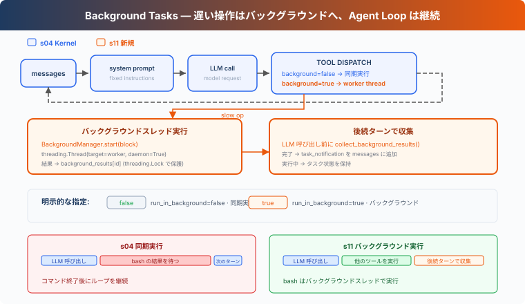

# s11: Background Tasks — 遅い操作はバックグラウンドへ

[English](README.md) · [中文](README.zh.md) · [日本語](README.ja.md)

s01 → ... → s09 → s10 → `s11` → [s12](../s12_cron_scheduler/) → s13 → ... → s16 → s17

> *"遅い操作はバックグラウンドへ、Agent Loop は処理を継続"* — バックグラウンドスレッドでコマンドを実行し、後続のターンで完了結果を収集する。
>
> **Harness 層**: バックグラウンド — 非同期実行、メインループをブロックしない。

---

## 課題

ファイルの読み込みや `git status` は通常すぐに返るため、同期実行でも待ち時間はほとんど気にならない。しかし、依存関係のインストール、全テストの実行、プロジェクトのビルドには数分かかることがある。コマンドが返るまで、Harness は現在のレスポンスに含まれる次のツール呼び出しを処理できず、次のターンにも進めない。

後続の作業がそのコマンドに依存しないなら、終了まで待つ必要はない。例えば全テストを開始した後も、テストの実行中にドキュメントを確認したり、別のファイルを整理したりできる。

S11 では、時間のかかる Bash コマンドをバックグラウンドで実行し、Agent Loop が他の作業を続けられるようにする。完了結果は後続のターンで収集する。

---

## ソリューション



この章では、時間のかかる操作をバックグラウンドスレッドに送る。現在のツール呼び出しはまずプレースホルダー `tool_result` を返すため、Agent Loop は処理を続けられる。後続のターンの開始時に完了済みの結果を収集し、通知として会話に追加する。

同期 vs バックグラウンド：

| | 同期 (s04) | バックグラウンド (s11) |
|---|---|---|
| 遅い操作 | 現在のツール呼び出しがブロックされる | バックグラウンドスレッドで実行 |
| Agent Loop | コマンドの返却を待つ | プレースホルダー結果を受け取って続行 |
| 結果 | コマンド終了後に返す | 先に `bg_id` を返し、後続のターンで結果を収集 |
| 判断基準 | — | bash の `run_in_background` パラメータ |

---

## 仕組み

### should_run_background: 明示的リクエスト

モデルは bash ツールの `run_in_background` パラメータでバックグラウンド実行をリクエストする。ツールが bash で、パラメータが明示的に `true` の場合だけ、この経路に入る。他の呼び出しは同期実行を続ける：

```typescript
function should_run_background(
  tool_name: string,
  tool_input: Record<string, any>,
): boolean {
  return tool_name === "bash" && tool_input.run_in_background === true;
}
```

`install`、`build`、`test` などのキーワードから推測しない。実行方法はツール呼び出しが明示的に選ぶ。

### BackgroundManager: バックグラウンド実行とライフサイクル

`BackgroundManager` がタスク状態と完了キューを保持する。`start()` はタスクを登録して daemon スレッドを起動し、すぐに `bg_id` を返す：

```typescript
class BackgroundManager {
  tasks: Record<string, any> = {};
  results: Record<string, string> = {};
  _ready: string[] = [];
  _lock = new SyncLock();

  start(block: any): string {
    // Register the task, then run _run() without blocking the agent loop.
    const task_id = "bg_0001";
    void this._run(task_id, block.input.command);
    return task_id;
  }

  async _run(task_id: string, command: string): Promise<void> {
    const [output, exit_code] = await _run_bash_process(command);
    const status = exit_code === 0 ? "completed" : "failed";
    this._lock.acquire();
    try {
      this.tasks[task_id]["status"] = status;
      this.results[task_id] = _format_bash_result(output, exit_code);
      this._ready.push(task_id);
    } finally {
      this._lock.release();
    }
  }
}
```

command が非ゼロで終了した場合や worker で例外が起きた場合は `failed` となる。Shell は独立した process group で起動し、command の完了、timeout、または Agent が通常経路や `SIGTERM` で終了する時に元の group を停止する。これは lifecycle cleanup であって sandbox ではなく、別の session を作った process は group から離れられる。

### collect_background_results: 通知収集

後続のターンの開始時に、`collect()` が完了キューから結果を取り出し、`<task_notification>` メッセージとしてフォーマットする：

```typescript
function collect_background_results(): string[] {
  return BACKGROUND.collect();
}
```

通知は元の `tool_use_id` を再利用しない。元のツール呼び出しはプレースホルダー `tool_result` で応答済みであり、完了結果を収集した時点で `task_notification` 形式の独立したイベントとして会話に追加する。1 つの `tool_use` に対応する `tool_result` は 1 つのままである。

### ループ統合

各 LLM 呼び出しの前に、Agent Loop は完了済みのバックグラウンド結果を収集する。`execute_tool()` は引き続きメインスレッドで `PreToolUse` を実行し、その後で同期実行かバックグラウンド実行かを選ぶ：

```typescript
while (true) {
  inject_background_results(messages);
  const response = await client.messages.create({
    model: MODEL,
    system: SYSTEM,
    messages,
    tools: TOOLS,
    max_tokens: 8000,
  });
}

async function execute_tool(block: any): Promise<string> {
  const blocked = await trigger_hooks("PreToolUse", block);
  if (blocked !== null && blocked !== undefined) return String(blocked);
  let output: string;
  if (should_run_background(block.name, block.input)) {
    const task_id = start_background_task(block);
    output = `[Background task ${task_id} started]`;
  } else {
    output = await call_tool(block);
  }
  await trigger_hooks("PostToolUse", block, output);
  return output;
}
```

遅い操作はまず `bg_id` 付きプレースホルダー tool_result を返す。バックグラウンドタスクの完了だけでは Agent は起動せず、次に Agent Loop が動く時に `inject_background_results()` が結果を収集する。

### 組み合わせて実行

```
Turn 1:
  LLM → bash "npm install" (run_in_background=true)
  → start_background_task → bg_0001
  → tool_result: "[Background task bg_0001 started]..."
  → LLM: "OK, I'll check later. Let me also read the config."

Turn 2:
  LLM → read_file "package.json" (fast, sync)
  → tool_result: file content

Turn 3:
  → collect bg_0001 as <task_notification>
  → LLM sees: config file + install notification in one message
```

npm install がバックグラウンドで実行されている間、Agent Loop は read_file を続けて実行した。

---

## s11 で追加するもの

| コンポーネント | S04 Kernel | S11 |
|--------------|------------|------------|
| 実行モデル | すべて同期 | 遅い操作はバックグラウンドスレッド + 通知注入 |
| bash スキーマ | `command` | `command` + `run_in_background` |
| 新規関数 | — | `should_run_background`, `start_background_task`, `collect_background_results`, `inject_background_results` |
| 新規型 | — | `BackgroundManager` |
| 通知形式 | — | `<task_notification>`（tool_use_id を再利用しない） |
| ループ動作 | ツールを同期実行 | 明示的なバックグラウンド実行、後続のターンで完了結果を収集 |
| ツール | 5 | 5（bash スキーマにパラメータを 1 つ追加） |

---

## 試してみる

```sh
cd learn-claude-code
npx tsx s11_background_tasks/code.ts
```

以下のプロンプトを試してください：

1. `Run pip list in the background and find all Python files in this directory`
2. `Run npm install (use run_in_background) and while waiting, read package.json`
3. `Run a short sleep in the background, then list all Markdown files`

観察ポイント：`run_in_background` を明示的に設定すると、コマンドがバックグラウンドに送られるか？`bg_id` は返されるか？後続のターンで完了結果が `<task_notification>` 形式で収集されるか？

---

## 次の章

バックグラウンドタスクは「遅い操作がブロックしない」を解決した。しかし、定期的に何かをしたい場合は？例えば「毎朝 9 時にテストを実行」「5 分ごとにサーバーステータスを確認」。

s12 Cron Scheduler → Agent にアラームクロックを付ける。


<!-- translation-sync: zh@v7, en@v7, ja@v7 -->
