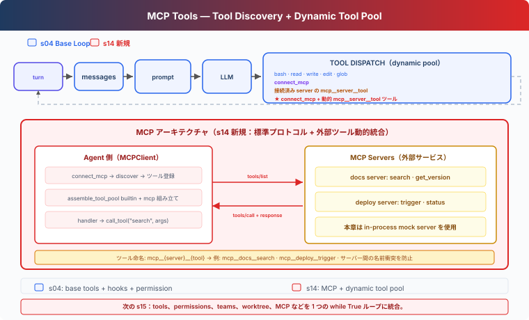

# s14: MCP Tools — 外部ツールの発見と呼び出し

[English](README.md) · [中文](README.zh.md) · [日本語](README.ja.md)

[s04](../s04_hooks/) → `s14` → [s15](../s15_integrated_harness/) → s16 → s17

> **Harness レイヤー**：MCP Tools — service に接続し、tool を発見して Agent Loop に追加する。

---

## 課題

これまでの基本ツールは `code.ts` に直接書かれている。documentation system と deployment platform を接続するために `search_docs`、`deploy_status`、`trigger_deploy` を追加することはできるが、service が増えるたびに tool definition、parameter schema、call handler を追加する必要がある。

MCP はこの責務を分ける。server は tool list と invocation endpoint を提供する。Harness は接続、model-facing name、permission check を担当し、発見した tool を model に渡す。

---

## ソリューション



本章は s04 の 5 つの基本ツールと Hooks から始め、次の 3 つを追加する：

- `MCPClient` は server が返した tool definition と call handler を保持する。
- `connect_mcp` は 1 つの server に接続して tool list を取得する。
- `assemble_tool_pool` は基本ツールと接続済み server の MCP tool を 1 つの tool pool にまとめる。

`docs` と `deploy` は、`tools/list`、`tools/call`、dynamic tool pool を示すための in-process mock server である。本章では実際の MCP transport は実装しない。

---

## 仕組み

### 1. 基本の Agent Loop は変わらない

各 model call の前に現在の tool pool を組み立てる：

```typescript
async function agent_loop(messages: any[]): Promise<void> {
  while (true) {
    const [tools, handlers] = assemble_tool_pool();
    const response = await client.messages.create({
      model: MODEL,
      system: assemble_system_prompt(),
      messages,
      tools,
      max_tokens: 8000,
    });
    // ...
  }
}
```

新しい server を接続すると、次の `assemble_tool_pool()` がその tool を model input に追加する。実行結果は従来通り `tool_result` として messages に追加される。

### 2. MCPClient は発見結果と呼び出し入口を保持する

```typescript
class MCPClient {
  register(tool_defs: any[], handlers: Record<string, (args: any) => any>): void {
    this.tools = [...tool_defs];
    this._handlers = { ...handlers };
  }

  call_tool(tool_name: string, args: Record<string, any>): string {
    const handler = this._handlers[tool_name];
    if (!handler) {
      return `MCP error: unknown tool '${tool_name}'`;
    }
    try {
      return String(handler(args));
    } catch (error) {
      const exc = error as Error;
      return `MCP error: ${exc.name}: ${exc.message}`;
    }
  }
}
```

`register()` は発見した tool list、`call_tool()` は invocation boundary を表す。error は Agent Loop を終了させず model へ返す。

### 3. connect_mcp は接続と発見だけを行う

```typescript
function connect_mcp(name: string): string {
  if (name in mcp_clients) {
    return `MCP server '${name}' already connected`;
  }
  const factory = MOCK_SERVERS[name];
  if (!factory) {
    return `Unknown server '${name}'`;
  }
  const server = factory();
  mcp_clients[name] = server;
  // ...
}
```

開始時、model が見るのは 5 つの基本ツールと `connect_mcp` だけである。`connect_mcp(name="docs")` の後、Harness は docs client を保持し、次の model call に次の tool が加わる：

```text
mcp__docs__search
mcp__docs__get_version
```

### 4. prefix で別 server の同名 tool を区別する

複数の server が `search` や `status` を提供することがある。Harness は次の名前を使う：

```text
mcp__{server}__{tool}
```

`normalize_mcp_name()` は model tool name に使えない文字を underscore に置き換える。tool pool の組み立て時には、正規化後の名前衝突と 64 文字制限も確認する：

```typescript
const prefixed = `mcp__${safe_server}__${safe_tool}`;
if (prefixed in origins) {
  throw new Error("MCP tool name collision after normalization");
}
```

そのため `docs.one/get.version` と `docs_one/get_version` が同じ名前へ暗黙に変換されることはない。

### 5. tool definition と handler を同時に追加する

```typescript
tools.push({
  "name": prefixed,
  "description": tool_def["description"] ?? "",
  "input_schema": schema,
});
handlers[prefixed] = ((client, tool) => {
  return (kwargs: Record<string, any>) => client.call_tool(tool, kwargs);
})(server, raw_name);
```

model は prefix 付きの名前を見る。handler は server の元の tool name で `MCPClient` を呼ぶ。default argument が現在の client と tool を保持するため、loop 内の lambda がすべて最後の tool を参照することはない。

### 6. permission は host が決める

MCP server は `readOnlyHint` や `destructiveHint` を返せるが、それらは server 由来の hint であり authorization ではない。本章では host-side policy を使う：

```typescript
const MCP_HOST_POLICY: Record<string, Record<string, string>> = {
  docs: {
    search: "allow",
    get_version: "allow",
  },
  deploy: {
    status: "allow",
    trigger: "confirm",
  },
};
```

`permission_hook()` は正規化された tool name からこの policy を調べる。設定されていない外部ツールは、default で user confirmation を必要とする。description に `readOnly` と書かれていても自動許可されない。

### 7. 入力 error は tool boundary 内に留める

model は required argument を省略したり、server が受け付けない field を送ることがある。`execute_tool()` と `MCPClient.call_tool()` は error を捕捉し、error `tool_result` を返す：

```text
MCP error: TypeError: <lambda>() missing 1 required argument: 'query'
```

lesson script を終了せず、model は次の turn で argument を修正できる。

---

## s04 からの変更

| コンポーネント | s04 | s14 |
|---|---|---|
| 基本ツール | 5 つの固定ツール | 変更なし |
| ツールソース | `code.ts` 内の定義 | 基本ツールと発見した MCP tool |
| ツールプール | 固定 `TOOLS` | 各 turn に `assemble_tool_pool()` で組み立て |
| 外部ツール名 | なし | `mcp__{server}__{tool}` |
| Permission | Shell と path check | host-side MCP policy を追加 |
| MCP transport | なし | in-process mock server で boundary を示す |

本章には Task、Background、Cron、Team、Worktree を持ち込まない。これらは s15 Integrated Harness で MCP と合流する。

---

## 試してみる

```sh
cd learn-claude-code
npx tsx s14_mcp_plugin/code.ts
```

入力：

```text
docs server に接続し、agent hooks を検索して、現在の documentation API version を教えてください。
```

典型的な tool trace：

```text
connect_mcp(name="docs")
mcp__docs__search(query="agent hooks")
mcp__docs__get_version()
```

続けて入力：

```text
deploy server に接続して web service の status を確認してください。deployment は trigger しないでください。
```

`status` は host policy によりそのまま実行され、`trigger` は user confirmation を必要とする。

---

## 次の章

ここでは MCP は独立した course branch である。s15 Integrated Harness は基本ツール、Hooks、Skills、Context、Memory、Task、Background、Cron、Teams、MCP を 1 つの runtime にまとめる。

<!-- translation-sync: zh@v9, en@v9, ja@v9 -->
