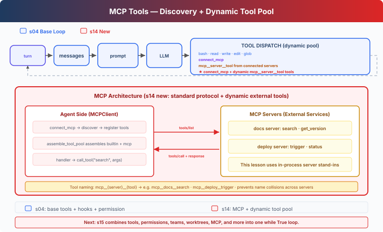

# s14: MCP Tools — Discover and Invoke External Tools

[English](README.md) · [中文](README.zh.md) · [日本語](README.ja.md)

[s04](../s04_hooks/) → `s14` → [s15](../s15_integrated_harness/) → s16 → s17

> **Harness layer**: MCP Tools — connect to services, discover tools, and add them to the agent loop.

---

## The Problem

The base tools in earlier chapters are written directly in `code.ts`. We could integrate a documentation system and deployment platform by adding `search_docs`, `deploy_status`, and `trigger_deploy`, but every service would require another set of tool definitions, parameter schemas, and call handlers.

MCP separates those responsibilities. A server provides a tool list and invocation endpoint. The harness connects to it, assigns model-facing names, applies permission checks, and gives the discovered tools to the model.

---

## The Solution



This chapter starts from s04's five base tools and hooks, then adds three parts:

- `MCPClient` stores the tool definitions and call handlers returned by a server.
- `connect_mcp` connects to one server and obtains its tool list.
- `assemble_tool_pool` combines the base tools with tools from every connected server.

The `docs` and `deploy` servers are in-process stand-ins for `tools/list`, `tools/call`, and a dynamic tool pool. This chapter does not implement a real MCP transport.

---

## How It Works

### 1. The base agent loop stays the same

Before each model call, the harness assembles the current tool pool:

```typescript
async function agent_loop(messages: any[]): Promise<void> {
  while (true) {
    const [tools, handlers] = assemble_tool_pool();
    const response = await client.messages.create({
      model: MODEL,
      system: assemble_system_prompt(),
      messages,
      tools,
      max_tokens: 8000,
    });
    // ...
  }
}
```

After a new server connects, the next `assemble_tool_pool()` call adds its tools to the model input. Tool results are still appended to messages as `tool_result` blocks.

### 2. MCPClient stores discovery results and call handlers

```typescript
class MCPClient {
  register(tool_defs: any[], handlers: Record<string, (args: any) => any>): void {
    this.tools = [...tool_defs];
    this._handlers = { ...handlers };
  }

  call_tool(tool_name: string, args: Record<string, any>): string {
    const handler = this._handlers[tool_name];
    if (!handler) {
      return `MCP error: unknown tool '${tool_name}'`;
    }
    try {
      return String(handler(args));
    } catch (error) {
      const exc = error as Error;
      return `MCP error: ${exc.name}: ${exc.message}`;
    }
  }
}
```

`register()` represents the discovered tool list. `call_tool()` represents the invocation boundary. Errors return to the model instead of terminating the agent loop.

### 3. connect_mcp only connects and discovers

```typescript
function connect_mcp(name: string): string {
  if (name in mcp_clients) {
    return `MCP server '${name}' already connected`;
  }
  const factory = MOCK_SERVERS[name];
  if (!factory) {
    return `Unknown server '${name}'`;
  }
  const server = factory();
  mcp_clients[name] = server;
  // ...
}
```

Initially, the model sees the five base tools and `connect_mcp`. After `connect_mcp(name="docs")`, the harness stores the docs client. The next model call also sees:

```text
mcp__docs__search
mcp__docs__get_version
```

### 4. Prefixes separate tools from different servers

Several servers may expose `search` or `status`. The harness uses:

```text
mcp__{server}__{tool}
```

`normalize_mcp_name()` replaces characters outside the model tool-name alphabet with underscores. Tool-pool assembly also checks normalized-name collisions and the 64-character limit:

```typescript
const prefixed = `mcp__${safe_server}__${safe_tool}`;
if (prefixed in origins) {
  throw new Error("MCP tool name collision after normalization");
}
```

As a result, `docs.one/get.version` and `docs_one/get_version` cannot silently map to the same name.

### 5. Tool definitions and handlers enter the pool together

```typescript
tools.push({
  "name": prefixed,
  "description": tool_def["description"] ?? "",
  "input_schema": schema,
});
handlers[prefixed] = ((client, tool) => {
  return (kwargs: Record<string, any>) => client.call_tool(tool, kwargs);
})(server, raw_name);
```

The model sees the prefixed name. The handler calls `MCPClient` with the server's original tool name. Default arguments capture the current client and tool so every lambda does not point to the last item in the loop.

### 6. The host decides permissions

An MCP server may provide `readOnlyHint` or `destructiveHint`, but those hints come from the server and are not authorization. This chapter uses a host-side policy:

```typescript
const MCP_HOST_POLICY: Record<string, Record<string, string>> = {
  docs: {
    search: "allow",
    get_version: "allow",
  },
  deploy: {
    status: "allow",
    trigger: "confirm",
  },
};
```

`permission_hook()` looks up this policy using the normalized tool name. An unconfigured external tool requires confirmation by default. A description containing `readOnly` does not make a tool trusted.

### 7. Input errors stay at the tool boundary

The model may omit a required argument or send a field the server does not accept. Both `execute_tool()` and `MCPClient.call_tool()` catch those errors and return an error `tool_result`:

```text
MCP error: TypeError: <lambda>() missing 1 required argument: 'query'
```

The model can correct its arguments on the next turn without terminating the lesson script.

---

## What Changed from s04

| Component | s04 | s14 |
|---|---|---|
| Base tools | Five fixed tools | Unchanged |
| Tool source | Definitions in `code.ts` | Base tools plus discovered MCP tools |
| Tool pool | Fixed `TOOLS` | Built each turn by `assemble_tool_pool()` |
| External tool names | None | `mcp__{server}__{tool}` |
| Permission | Shell and path checks | Adds a host-side MCP policy |
| MCP transport | None | In-process server stand-ins demonstrate the boundary |

This chapter does not carry Task, Background, Cron, Team, or Worktree. They join MCP in the s15 Integrated Harness.

---

## Try It Out

```sh
cd learn-claude-code
npx tsx s14_mcp_plugin/code.ts
```

Enter:

```text
Connect to the docs server, search for agent hooks, and tell me the current documentation API version.
```

A typical tool trace is:

```text
connect_mcp(name="docs")
mcp__docs__search(query="agent hooks")
mcp__docs__get_version()
```

Then enter:

```text
Connect to the deploy server and check the web service status. Do not trigger a deployment.
```

`status` runs under the host policy. `trigger` requires user confirmation.

---

## What's Next

MCP is still an independent course branch here. s15 Integrated Harness combines the base tools, hooks, skills, context, memory, tasks, background work, cron, teams, and MCP in one runtime.

<!-- translation-sync: zh@v9, en@v9, ja@v9 -->
