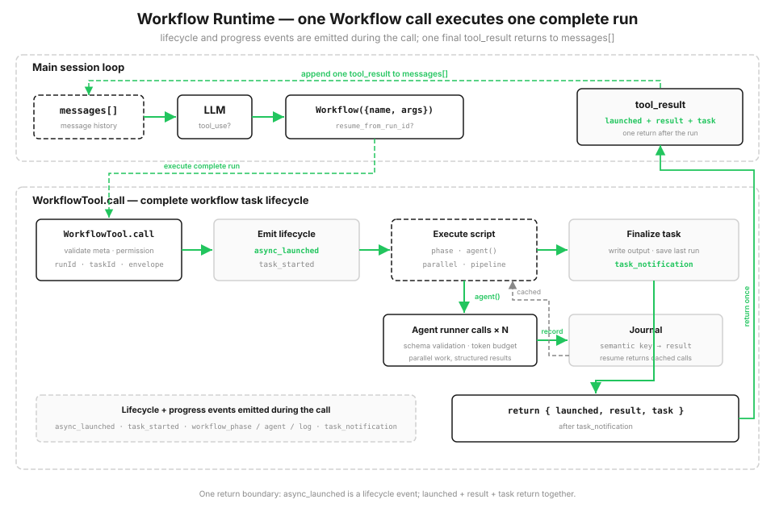

# s16: Workflow Runtime — モデルが単一 step を決め、script が orchestration を決める

[English](README.md) · [中文](README.zh.md) · [日本語](README.ja.md)

s01 → ... → s14 → [s15](../s15_integrated_harness/) → `s16` → [s17](../s17_goal_loop/)

> *「1 回の tool_use で、一式の orchestration を実行する」* — `Workflow` ツールが復元可能な script runtime を起動し、多数の agent call を協調させます。
>
> **Harness 層**: Orchestration — single-agent loop の上で保存済み multi-agent script を実行します。

---

s01 から s15 まで、各 round で model が呼び出す tools を決めます。tool results が `messages[]` に入ると、model は更新された context から次の step を決めます。次の経路が前の step の発見に依存する task に向いています。

一方、固定された流れを繰り返す task もあります。code review なら、複数の観点を同時に調べ、各 finding を検証し、重複をまとめて severity 順に並べます。実行前に step と順序が分かっている場合、host には次の 3 つが必要です。

- **並行性**: 1 件ずつ順番に待たないこと。
- **安定した結果構造**: 個々の agent answer が変わっても構造を保つこと。
- **復元可能性**: 途中で止まっても、完了済みの部分を最初からやり直さないこと。

この orchestration が conversation history にしか存在しなければ、順序と checkpoint も history にしか残りません。saved workflow は固定 flow を code に置き、完了した call を journal に記録します。

## 計画は chat のラウンドを重ねず、コードに書く

harness の tool pool に `Workflow` ツールを追加します。host は `agent() / parallel() / pipeline() / phase()` で構成した trusted script を登録します。model が渡すのは saved workflow name、argument、任意の resume run ID だけで、実行可能 code や metadata は渡しません。

workflow は 1 回の `tool_use` として main loop に入ります。script の実行中、runtime は lifecycle event と progress event を出し、各 step を disk journal へ記録します。script が終わると、この call は launch 情報、result、task state を返します。script の中間結果は変数に保存され、conversation history を使いません。`resume_from_run_id` で再開すると、変更されていない `agent()` は journal の結果を再利用します。



```typescript
const SAMPLE_META = {"name": "review-changes", "description": "コード変更を review", "phases": ["Review", "Verify"]};

async function sample_workflow(ctx: any, args: any): Promise<any> {
  ctx.phase("Review");
  const results = await ctx.pipeline(DIMENSIONS, audit, verify);   // 各 dimension が独立して audit → verify を通る
  const confirmed = results.filter((r: any) => r).flatMap((r: any) => r["confirmed"]);
  ctx.log(`${confirmed.length} 件の実在する問題を確認`);
  return {"confirmed": confirmed};
}
```

## Workflow ツール: 1 回の call で run 全体を実行する

`Workflow` は s15 host の既存 tool pool に追加されます。ユーザーが保存済み workflow の実行を求めるか、タスクが既知の orchestration に一致したときにモデルがこのツールを選びます。adapter は name を host-owned `WORKFLOWS` registry で解決し、trusted metadata と function を runtime へ渡します。s15 の他の tools も同じ loop で利用できます。

model-facing schema が受け取るのは `name`、`args`、`resume_from_run_id` です。unknown name や不正 argument は error tool result として返し、host loop を終了させません。その後 runtime が登録済み metadata を検証し、permission check を通し、local workflow task を登録して、script の実行前に `async_launched` を出します。progress event と最後の `task_notification` が続き、call は JSON-safe な launch 情報、result、task state を返します。

```typescript
const WORKFLOW_TOOL = {
  "name": "Workflow",
  "input_schema": {
    "type": "object",
    "properties": {
      "name": {"type": "string"},
      "args": {"type": "object"},
      "resume_from_run_id": {"type": "string"},
    },
    "required": ["name"],
    "additionalProperties": false,
  },
};

async function run_workflow(name: string, args: any = null, resume_from_run_id: string | null = null): Promise<any> {
  const [meta, script_fn] = WORKFLOWS[name];
  const out = await new WorkflowTool().call(
    meta, script_fn,
    args,
    resume_from_run_id,
  );
  return {"launched": out["launched"], "result": out["result"],
          "task": serialize_task(out["task"])};
}
```

## Workflow metadata: 起動前に検証する

各 saved workflow は `name`、`description`、任意の `phases` を持つ trusted metadata を登録します。runtime は workflow code を実行する前に検証します。`name` と `description` は task と UI の表示に使い、`phases` は progress 表示の group 名を定義します。これらは model input ではなく host registry に属します。

不正な登録内容は launch 前に `WorkflowInputError` になります。s12 の cron 式検証と同じ考えです。不正な saved workflow が実行時まで進んでから壊れないようにします。

runtime は `meta.name` をローカル artifact のファイル名に使うため、英数字で始まり、英数字、`.`、`_`、`-` のみからなる 1-64 文字の安全な slug も要求する。

```typescript
function validate_meta(meta: any): any {
  if (meta === null || typeof meta !== "object" || Array.isArray(meta)) {
    throw new WorkflowInputError("meta は object literal でなければなりません");
  }
  if (!meta["name"] || !meta["description"]) {
    throw new WorkflowInputError("meta には name と description が必要です");
  }
  if (typeof meta["name"] !== "string" || !WORKFLOW_NAME_RE.test(meta["name"])) {
    throw new WorkflowInputError("meta.name は安全な 1-64 文字の slug が必要です");
  }
  if ("phases" in meta && (
    !Array.isArray(meta["phases"]) ||
    !meta["phases"].every((p: any) => typeof p === "string" && p)
  )) {
    throw new WorkflowInputError("meta.phases は空でない文字列だけを含む必要があります");
  }
  return meta;
}
```

## Orchestration primitive

script は少数の orchestration primitive だけを公開する `ExecutionState` を受け取り、ファイルを直接読み書きせず、shell も実行しません。default の interactive mode では `agent()` を host と同じ real API client に接続し、各 workflow agent は arguments で渡された内容だけを読みます。`demo` と unit test は `MockAgentRunner` を使い、event と journal replay を繰り返し確認できるようにします。

| Primitive | 役割 |
|------|------|
| `agent(prompt, {schema, label, phase})` | 1 つの subagent を派遣 |
| `parallel(thunks)` | **barrier**: すべての task を並行実行し、全結果が戻るまで待つ |
| `pipeline(items, *stages)` | 各 item を **barrier なし**で stage ごとに実行し、終わった item から先へ進める |
| `phase(title)` | 現在の progress phase を記録し、progress bar を更新 |
| `log(message)` | progress log を 1 行出力 |
| `workflow(name, args)` | nested sub-workflow（1 階層だけ） |

各 item が同じ stage を独立して通る場合は `pipeline` を使えます。item A が stage 3 にいる間、item B はまだ stage 1 かもしれません。次の処理が前の group の全結果を必要とする場合は `parallel` を使います。

```typescript
async function pipeline(items: any[], ...stages: Array<(value: any, item: any, index: number) => Promise<any>>): Promise<any[]> {
  const run_item = async (item: any, idx: number) => {
    let value = item;
    for (const stage of stages) {                       // 各 item がすべての stage を独立して完走
      value = await stage(value, item, idx);
    }
    return value;
  };
  return await Promise.all(items.map((it, i) => run_item(it, i)));
}
```

## 構造化出力: Subagent に散文を返させない

`agent({schema})` は、schema に一致する JSON object だけを返すよう workflow agent に要求します。runtime は結果を parse、validate し、不一致なら 1 回 retry します。下流コードは prose から field を取り出さず、object を受け取れます。

s05 では tool argument を全面的に信頼できないと説明しました。ここでは同じ教訓を逆向きに使います。subagent の出力も全面的には信頼できません。orchestration boundary で検証し、1 回 retry の機会を与え、不確実性を後続 flow の外へ止めます。

```typescript
let run = await this.runner.run(prompt, schema, label);
let result = run.value;
if (schema !== null) {
  let [ok, err] = new SimpleJsonSchema(schema).validate(result);
  if (!ok) {                                       // 1 回だけ注意して retry、それでも不正なら error
    const retry = await this.runner.run(
      prompt + "\n\n有効な JSON を返してください。", schema, label,
    );
    result = retry.value;
    [ok, err] = new SimpleJsonSchema(schema).validate(result);
    if (!ok) {
      throw new WorkflowInputError(`agent({schema}) の出力が不正です: ${err}`);
    }
  }
}
```

## Task state と progress event

`LocalWorkflowTask` は status と token usage を管理し、SDK style の event stream を外へ出します。`task_started` → phase change、subagent start、log を含む一連の `task_progress` → 完了または失敗に加え、output file、agent 数、token 数を含む最後の `task_notification` です。

demo はこれらの event を順番に表示し、最後の notification の後で task state を返します。

```typescript
class LocalWorkflowTask {
  progress: any[] = [];

  progress_event(ptype: string, data: Record<string, any> = {}): void {         // phase/subagent/log
    this.progress.push({"type": ptype, ...data});
    console.log(`  progress   ${ptype} ...`);
  }
}
```

## 保存: Snapshot + journal で中断から再開する

runtime は各 run を `s16_workflow_runtime/.runtime/` に保存します。`<runId>.json` snapshot、`<runId>.output.json` output、`<runId>.journal.jsonl` journal、`<runId>.lock` coordination file です。fresh run は journal を開く前に exclusive file creation で新しい `runId` を予約します。run lock は実行と最終永続化が終わるまで保持するため、別 process は同じ run を同時に resume できません。snapshot に workflow name、arguments、task state を記録し、resume は保存済み snapshot と journal を先に検証してから、成功済み artifact を変更します。

journal は checkpoint resume の中心で、各 `agent()` の結果を 1 行ずつ記録します。

```typescript
class WorkflowJournal {
  record(key: string, value: any): void {
    writeSync(this._fd, json_dumps({"key": key, "value": value}) + "\n");
    this.cache.set(key, value);
  }
}
```

## Resume: runId から続行し、変更のないものを再利用する

`resume_from_run_id` を渡して workflow を再度呼ぶと script を再実行しますが、各 `agent()` は決定的な semantic key を計算します。journal に key があれば、再実行せず cached result を返します。変更された call と、それに依存する後続 step だけが本当に動きます。

key は concurrency の完了順に依存してはいけません。`parallel` と `pipeline` の Agent は不定の順番で完了します。「何番目に完了したか」を key にすると、次回の cache が別の call へ対応してしまいます。そのため key は競合する counter ではなく、call の内容、つまり type、label、prompt、schema の stable hash です。

```typescript
function key(kind: string, label: string, prompt: string, schema: any): string {
  const basis = `${kind}|${label}|${prompt}|${json_dumps(schema, true)}`;
  const n = _stable_hash(basis) % (10n ** 10n);
  return `${kind}-${n.toString().padStart(10, "0")}`;
}

// agent() の内部:
const cached = this.journal.cached(key);
if (cached !== MISS) {
  this.task.progress_event("workflow_agent", { label, status: "cached" });
  return cached;
}
```

## Stable call key

resume では、現在の各 `agent()` call を以前の journal record と対応付ける必要があります。stable hash は変更されていない workflow code と arguments に同じ call key を与えます。real model の出力は変化しても、call 内容が同じなら journal に保存済みの result を使います。

## 実際に動かす

sample workflow `review-changes` は `pipeline` を使い、各 review dimension を独立して audit → verify へ通します。interactive mode は real API を使い、`args.changes` から review 対象を読みます。`demo` は固定 runner data で pipeline、validation、journal、resume を示します。

```typescript
async function sample_workflow(ctx: any, args: any): Promise<any> {
  ctx.phase("Review");
  const changes = Object.prototype.hasOwnProperty.call(args, "changes") ? args["changes"] : "";

  const audit = async (_v: any, dimension: string, _i: number) => {
    const out = await ctx.agent(`この変更に ${dimension} 関連の問題がないか確認してください:\n${changes}`,
                                FINDINGS_SCHEMA, `audit:${dimension}`, "Review");
    return {"dimension": dimension, "findings": out["findings"]};
  };

  const verify = async (audited: any, dimension: string, _i: number) => {
    ctx.phase("Verify");
    const verdicts = await ctx.parallel(                       // 各 finding を独立して verify
      audited["findings"].map((f: any) => () => ctx.agent(
        `変更内容に照らして finding を検証してください:\n${changes}\n\n${f}`,
        VERDICT_SCHEMA, `verify:${dimension}:${f["title"]}`)));
    return {"dimension": dimension,
            "confirmed": audited["findings"].filter((_f: any, i: number) => verdicts[i] && verdicts[i]["isReal"])};
  };

  const results = await ctx.pipeline(DIMENSIONS, audit, verify);
  // ...
}
```

## s15 からの変更点

| | s15 Integrated Harness | s16 Workflow Runtime |
|--|-----------|---------------------|
| loop | 1 つ、モデル駆動 | main loop は不変。tool の背後で script orchestration を実行 |
| 次の step を決めるもの | モデルが毎ラウンド判断 | script が orchestration flow を事前に定義 |
| multi-agent | s06 subagent を一度だけ派遣 | agent-runner boundary を通る scripted、resumable call |
| 新しい仕組み | — | orchestration primitive、host registry と tool adapter、task lifecycle、progress event、journal/resume、structured output |

s16 は main loop を置き換えません。tool layer に `Workflow` を公開し、背後で local workflow runtime を起動します。saved script が agent-runner boundary を通じて N 回の call を協調させます。s06 の subagent はモデルがその場で 1 回派遣し、s16 は orchestration を resumable な host code にします。

## 試してみる

```bash
npx tsx s16_workflow_runtime/code.ts          # main model と Workflow agent の両方が real API を使う
npx tsx s16_workflow_runtime/code.ts demo     # deterministic fixture と event stream を確認
npx tsx s16_workflow_runtime/code.ts resume   # 前回の runId から resume。すべての agent() が journal cache に当たる
```

default command では、model に changes を読ませ、その text を `args.changes` に入れて保存済み `review-changes` workflow を実行させます。main model と workflow agent の両方が real API を使います。`demo` は固定 runner data で lifecycle と resume を繰り返し観察でき、すべて cache hit した resume は `agents=0 tokens=0` と表示されます。

## 次へ

[s17 Goal Loop](../s17_goal_loop/) は、より小さな独立 loop で goal が達成されたかを確認し、次の round が必要かを判断します。

<!-- translation-sync: zh@v10, en@v10, ja@v10 -->
